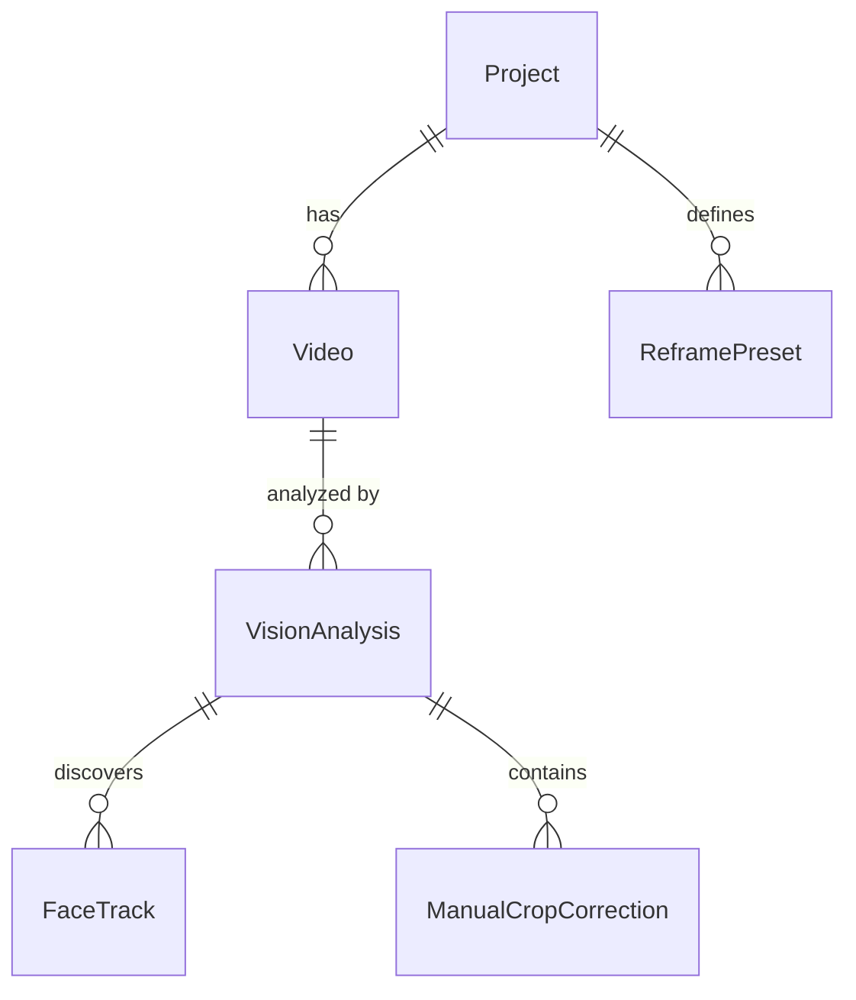

# ClipForge AI — Phase 6 Implementation Plan
## Visual AI, Face Tracking & Smart Reframing

**Author**: Senior Computer Vision Engineer & Backend Architect  
**Status**: APPROVED & IN PROGRESS  
**Date**: 2026-11-19  

---

## 1. System Overview & Objective

Phase 6 introduces local-first visual intelligence to ClipForge AI. Building on the core foundations of Phase 1–5 (Video Processing, faster-whisper Speech Transcription, and local GGUF AI Highlight Discovery), Phase 6 equips the application with automated computer vision to:
1. Detect human faces in source videos with normalized bounding boxes and facial landmarks.
2. Track detected subjects across time with stable, temporary video-local track IDs.
3. Analyze scene composition (single subject, multiple subjects, crowd, or no-face B-roll).
4. Provide multiple subject selection strategies: `largest_face`, `center_face`, `manual_track`, and `group`.
5. Compute smooth, cinematic crop trajectories for vertical (9:16), square (1:1), portrait (4:5), and landscape (16:9) formats.
6. Apply velocity-limited exponential temporal smoothing to eliminate camera jitter while preventing tracking lag.
7. Support manual user crop overrides and corrections via an interactive visual editor.
8. Render production-ready clips using the existing Phase 3 FFmpeg engine with verified audio/video streams.
9. Provide safe, graceful fallback for zero-face or low-confidence scenes (center-crop and blur-background).
10. Respect hardware constraints by executing sequentially on CPU with memory-safe frame sampling.

---

## 2. Reused Existing Modules

| Module Path | Role in Phase 6 | Modification Needed |
| :--- | :--- | :--- |
| `backend/app/video/ffmpeg_manager.py` | Subprocess execution with progress parsing | None (reused directly) |
| `backend/app/video/ffprobe_manager.py` | Technical stream metadata and crop validation | None (reused directly) |
| `backend/app/video/clip_generator.py` | Frame-accurate cutting and export | Extended to accept time-varying crop trajectory filtergraphs |
| `backend/app/video/aspect_ratio.py` | Aspect ratio filtergraph generator | Extended to support trajectory-driven crop expressions |
| `backend/app/workers/job_manager.py` | Single-heavy-worker bounded queue | Reused for visual analysis background jobs |
| `backend/app/workers/job_executor.py` | Job dispatch and lifecycle handler | Register `visual_analysis` job handler with 10-stage progress |
| `backend/app/workers/cancellation.py` | Thread-safe cooperative cancellation | Injected into frame sampling and tracking loops |
| `backend/app/core/database.py` | Async SQLite session management | Reused for new vision tables |
| `backend/app/core/config.py` | App paths and storage configuration | Reused for `models/vision/` directory |
| `backend/app/db/models.py` | SQLAlchemy database models | Add `VisionAnalysis`, `FaceTrack`, `ManualCropCorrection`, `ReframePreset` |
| `src/components/video/VideoPlayer.tsx` | HTML5 playback and seeking | Extended with overlay layer for bounding boxes and crop preview |
| `src/pages/ProjectStudio.tsx` | Studio interface | Add `Visual Reframing` workspace tab |

---

## 3. New Modules to Create

### Backend (`backend/app/ai/vision/`)
* **`schemas.py`**: Pydantic models for `NormalizedBBox`, `FacialLandmarks`, `FaceDetection`, `TrackedFace`, `SceneAnalysisResult`, `CropCoordinate`, `ReframeConfig`, `ManualCropInput`.
* **`face_detector.py`**: Multi-backend face detector:
  - Primary: `cv2.FaceDetectorYN` (OpenCV YuNet ONNX, ~232 KB, high-accuracy deep learning face detector with 5 facial landmarks).
  - Fallback: `cv2.CascadeClassifier` (OpenCV Haar Cascade `haarcascade_frontalface_default.xml`, zero-download offline fallback).
  - Configurable detection resolution, confidence threshold, and input scaling.
* **`face_tracker.py`**: Multi-object face tracker associating detections across sampled frames:
  - IoU-based spatial matching with Hungarian/Greedy assignment.
  - Kalman/exponential spatial smoothing of bounding boxes.
  - Temporary occlusion handling and missed detection grace period (patience = 5 frames).
  - Track ID lifecycle (temporary video-local identifiers: `track_1`, `track_2`).
* **`scene_analyzer.py`**: Scene classification:
  - Density of faces per second (single person vs multi-person dialogue vs audience).
  - Face size distribution and framing stability.
  - Scene shot change detection based on HSV histogram / frame difference.
* **`subject_selector.py`**:
  - `largest_face`: Selects subject with maximum average surface area.
  - `center_face`: Selects subject closest to composition optical center.
  - `manual_track`: Follows a user-selected track ID.
  - `group`: Calculates bounding hull enclosing all active subjects.
* **`reframe_engine.py`**:
  - Computes target crop dimensions for `9:16`, `1:1`, `4:5`, `16:9`.
  - Injects configurable headroom (10–25% above eyes/forehead) and side padding.
  - Applies Exponential Moving Average (EMA) smoothing with velocity limiter to prevent sudden camera jumps.
  - Clamps all coordinates `[0 <= x <= W - crop_w, 0 <= y <= H - crop_h]` to prevent FFmpeg out-of-bounds errors.
  - Produces smooth timestamped trajectory points `(timestamp, crop_x, crop_y, crop_w, crop_h)`.
* **`vision_manager.py`**:
  - Singleton inference coordinator with sequential execution lock (`asyncio.Lock`).
  - Pre-execution unloader for Whisper and LLM models.
  - Configurable frame sampling interval (default: 4–6 fps for analysis, saving CPU resources).
  - Post-execution memory cleanup.
* **`services/vision_service.py`**:
  - CRUD operations for `VisionAnalysis`, `FaceTrack`, `ManualCropCorrection`, and `ReframePreset`.
  - Trajectory generation and manual override integration.
* **`api/routes/vision.py`**:
  - `GET /api/vision/capabilities`: Detector status and CPU/GPU diagnostics.
  - `POST /api/videos/{id}/analyze-vision`: Dispatch asynchronous analysis job.
  - `GET /api/videos/{id}/vision`: Retrieve analysis, tracks, and scene statistics.
  - `POST /api/vision/trajectory`: Compute crop trajectory for given parameters.
  - `POST /api/vision/corrections`: Store manual keyframe crop adjustments.
  - `POST /api/vision/render-reframed-clip`: Render final vertical clip using computed trajectory.

---

## 4. Database Schema Additions

Four new relational entities added to `backend/app/db/models.py`:

1. **`vision_analyses`**:
   - `id`: UUID (PK)
   - `project_id`: FK -> `projects.id` (CASCADE)
   - `video_id`: FK -> `videos.id` (CASCADE)
   - `status`: String (`pending`, `analyzing`, `completed`, `failed`)
   - `model_name`: String (`yunet_2023mar`)
   - `processing_device`: String (`cpu_avx2`)
   - `duration_seconds`: Float
   - `sampled_frame_count`: Integer
   - `detected_face_count`: Integer
   - `scene_metadata`: JSON
   - `created_at`, `updated_at`: DateTime

2. **`face_tracks`**:
   - `id`: UUID (PK)
   - `analysis_id`: FK -> `vision_analyses.id` (CASCADE)
   - `track_identifier`: String (`track_1`)
   - `start_time`: Float
   - `end_time`: Float
   - `detection_count`: Integer
   - `average_confidence`: Float
   - `average_bbox`: JSON
   - `samples`: JSON (sampled timestamps and normalized `[x, y, w, h]` boxes)
   - `created_at`: DateTime

3. **`manual_crop_corrections`**:
   - `id`: UUID (PK)
   - `analysis_id`: FK -> `vision_analyses.id` (CASCADE)
   - `timestamp`: Float (seconds)
   - `crop_x`: Float
   - `crop_y`: Float
   - `crop_width`: Float
   - `crop_height`: Float
   - `created_at`, `updated_at`: DateTime

4. **`reframe_presets`**:
   - `id`: UUID (PK)
   - `project_id`: FK -> `projects.id` (CASCADE)
   - `name`: String
   - `aspect_ratio`: String (`9:16`, `1:1`, `4:5`, `16:9`)
   - `selection_strategy`: String (`largest_face`, `center_face`, `manual_track`, `group`)
   - `smoothing_strength`: Float (0.1–1.0)
   - `crop_padding`: Float
   - `headroom`: Float
   - `created_at`, `updated_at`: DateTime

---

## 5. Sequential Model & Hardware Resource Management

1. **VRAM / RAM Budget Protection**:
   - Target machine has 16 GB RAM and 8 GB VRAM.
   - When visual analysis starts, `VisionManager` invokes `TranscriptionEngine.get_instance().unload_model()` and `LLMInferenceManager.get_instance().unload()`.
   - Vision analysis operates on sampled frames (e.g., 4 fps rather than 30 or 60 fps), reducing frame decoding overhead by **85%**.
   - Frame buffers are processed as NumPy arrays and released immediately to prevent memory growth.
   - Analysis uses lightweight proxy / downscaled frames (maximum 640px width for detection), preserving full-resolution video for final FFmpeg export.

---

## 6. Testing & Acceptance Strategy

1. **Unit Test Suite (`backend/tests/test_phase6.py`)**:
   - **Detection**: Valid frames, synthetic face patterns, empty frames, zero-face frames, multiple faces, normalized coordinate clamping.
   - **Tracking**: Single-face tracking across frames, multi-face track continuity, crossing trajectories, occlusion handling, track ID stability.
   - **Reframing Math**: 16:9 to 9:16, 1:1, 4:5, boundary clamping, EMA smoothing, headroom calculations, zero-face fallback.
   - **Persistence & API**: Schema validation, database persistence, job lifecycle, cancellation, manual crop updates.

2. **Real-Video Acceptance Test (`backend/acceptance_phase6_real.py`)**:
   - Video with single speaker (`acceptance_speech_35s.mp4`).
   - Video with multiple faces.
   - Video with zero faces (synthetic pattern/scene).
   - Verify FFprobe output dimensions (1080x1920), duration, audio preservation, and temporal smoothness.
   - Generate `PHASE6_FINAL_ACCEPTANCE_REPORT.md` with measured metrics.

---

## 7. Risks & Mitigation

| Risk | Mitigation |
| :--- | :--- |
| Huge FFmpeg command length for long video crop trajectories | Sample trajectory at key intervals (e.g. 0.5s) and construct smooth linear interpolation expressions (`x='if(lte(t, t1), ...)'`), or split into sub-second segment filtergraphs. |
| Subject moving out of frame during fast cuts | Scene change detection resets tracking and re-anchors crop without dragging across scenes. |
| CPU lag on 4K source footage | Downsample frames to 640px for detection and tracking; apply computed normalized coordinates to full resolution during final render. |
| Inaccurate face detection in low light | Dual detector architecture: YuNet deep ONNX model with Haar Cascade fallback; automatic confidence thresholding. |
