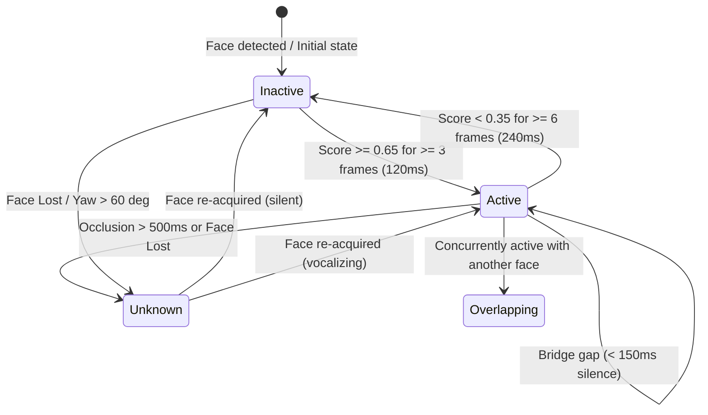

# ClipForge AI — Multi-Evidence Audio-Visual Fusion Engine

## Theoretical Foundation, Signal Normalization & State Transition Architecture

### 1. Conceptual Separation: Concept A vs. Concept B

A critical requirement of Phase 8 Stage 4 is maintaining a strict mathematical distinction between:
- **Concept A (Instantaneous Active Speaker Detection)**:
  Answering the continuous temporal question: *Which visible human entity (or off-screen voice) is actively producing speech sounds at timestamp $t$?*
  This is evaluated per face track across frames and outputs temporal intervals tagged with confidence and functional state (`active_speaker`, `silent_listener`, `off_screen_speaker`, `unknown`, `overlapping`).
- **Concept B (Global Identity Association)**:
  Answering the global bipartite clustering question: *Which acoustic Diarization Speaker ID ($S_i$, e.g., `SPEAKER_00`) corresponds to which physical visual Face Track ($T_j$, e.g., `face_track_0`) throughout the duration of the entire project?*
  This is evaluated by aggregating acoustic turns and visual intervals across multiple dialogue exchanges.

---

### 2. Multi-Evidence Signal Normalization

The fusion engine ingests heterogenous signals across acoustic and visual modalities. Signals are normalized into canonical $[0.0, 1.0]$ ranges:

| Signal Source | Raw Measurement | Normalization Formula | Canonical Range | Functional Role |
| :--- | :--- | :--- | :--- | :--- |
| **Light-ASD Multimodal** | Raw logits $(l_{\text{neg}}, l_{\text{pos}})$ | Softmax probability $\sigma(l_{\text{pos}}) = \frac{e^{l_{\text{pos}}}}{e^{l_{\text{pos}}} + e^{l_{\text{neg}}}}$ | $[0.0, 1.0]$ | Primary cross-modal audio-visual correlation |
| **Lip Velocity** | MAR derivative $\frac{d\text{MAR}}{dt}$ | $v_{\text{norm}} = \text{clip}\left(\frac{\|\Delta \text{MAR} / \Delta t\|}{6.0}, 0.0, 1.0\right)$ | $[0.0, 1.0]$ | Rapid articulatory opening/closing detection |
| **Lip Variance** | MAR rolling variance (window $W=5$) | $\text{var}_{\text{norm}} = \text{clip}\left(\frac{\text{Var}(\text{MAR})}{0.015}, 0.0, 1.0\right)$ | $[0.0, 1.0]$ | Distinguishes speech from static open mouth |
| **Silero VAD** | Acoustic speech probability $p_{\text{vad}}$ | Interval intersection $t \in [t_{\text{start}}, t_{\text{end}}]$ | $\{0.0, 1.0\}$ | Soft acoustic modulation gate |
| **AV Synchronizer** | Correlation offset confidence | Gaussian penalty based on stream sync | $[0.0, 1.0]$ | Attenuates out-of-sync frames |

#### Composite Score Formulation:
The visual-multimodal score is computed as:
$$S_{\text{raw}} = (w_{\text{asd}} \cdot P_{\text{asd}} + w_{\text{lip}} \cdot (0.70 \cdot v_{\text{norm}} + 0.30 \cdot \text{var}_{\text{norm}})) \cdot C_{\text{sync}}$$
where $w_{\text{asd}} = 0.70$ and $w_{\text{lip}} = 0.30$.

The acoustic VAD acts as a soft modulating signal rather than a destructive kill-switch:
- **When VAD is Active**:
  $$S_{\text{composite}} = \text{clip}(S_{\text{raw}} \times 1.05, 0.0, 1.0)$$
- **When VAD is Inactive**:
  - If $S_{\text{raw}} > 0.80$ and lip score $> 0.60$ (indicating faint or whispering speech missed by acoustic VAD):
    $$S_{\text{composite}} = S_{\text{raw}} \times 0.85$$
  - Otherwise (silent mouth motions like chewing, yawning, smiling, or quiet listening):
    $$S_{\text{composite}} = S_{\text{raw}} \times 0.35$$

---

### 3. State Machine & Transition Rules

#### Temporal Stability Parameters:
- **Onset Threshold ($\tau_{\text{on}} = 0.65$)**: Requires $N_{\text{on}} \ge 3$ consecutive frames (~120 ms) above threshold to trigger activation, eliminating single-frame optical jitter.
- **Offset Threshold ($\tau_{\text{off}} = 0.35$)**: Requires $N_{\text{off}} \ge 6$ consecutive frames (~240 ms) below threshold to deactivate, preventing premature cutoff during brief consonant stops.
- **Gap Bridging ($< 150\text{ ms}$)**: Silences shorter than 150 ms between speech bursts in the same track are merged into a continuous active utterance.
- **Minimum Duration ($\ge 250\text{ ms}$)**: Spurious bursts shorter than 250 ms are filtered out.
- **Scene-Cut Awareness**: When a scene cut occurs (e.g. shot transition), gap bridging is inhibited and temporal hysteresis is reset to prevent ghost active segments across camera cuts.
