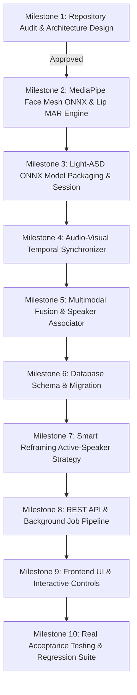

# CLIPFORGE AI — PHASE 8, STAGE 4
# AUDIO-VISUAL ACTIVE SPEAKER DETECTION IMPLEMENTATION PLAN

## Overview & Execution Strategy

Phase 8, Stage 4 introduces real-time audio-visual active speaker detection (AV-ASD) and global speaker-to-face identity association into ClipForge AI.

This implementation plan outlines the step-by-step roadmap from Step 1 (current audit) through full production integration and acceptance testing. Every milestone follows ClipForge AI's core principles:
1. **100% Local-First & Offline**: Zero cloud APIs, zero external tokens, zero runtime telemetry.
2. **CPU-First Performance**: Must maintain steady-state RTF < 0.20x on Intel Core i7-13620H with GPU acceleration optional.
3. **Additive Architecture**: Zero breaking changes to existing Phase 1–8 functionality.
4. **Strict Verification**: Every step backed by measurable unit, integration, and regression tests.

---

## Milestone Roadmap

---

### Milestone 1: Repository Audit & Architecture Design (Step 1 — In Progress)
- **Status**: Audit and evaluations complete; architecture and implementation documents produced.
- **Deliverables**:
  - `docs/PHASE8_STAGE4_REPOSITORY_AUDIT.md`
  - `docs/PHASE8_STAGE4_MODEL_EVALUATION.md`
  - `docs/PHASE8_STAGE4_ARCHITECTURE.md`
  - `docs/PHASE8_STAGE4_IMPLEMENTATION_PLAN.md`
- **Verification**: Run `pytest backend/tests/` to verify all 127 existing tests pass. Stop and wait for user approval before modifying code or downloading weights.

---

### Milestone 2: MediaPipe Face Mesh ONNX & Lip MAR Engine
- **Objective**: Implement vertical mouth opening extraction to replace the inadequate 5-point YuNet landmarks.
- **Tasks**:
  1. Package lightweight `face_landmark.onnx` (~2.8 MB, Apache-2.0 license) in `storage/clipforge_data/models/vision/`.
  2. Implement `backend/app/ai/vision/lip_motion_detector.py`:
     - Load ONNX session with CPUExecutionProvider.
     - Accept face crop bounding box from `FaceTrack`.
     - Extract inner upper lip (landmark 13) and inner lower lip (landmark 14).
     - Extract outer corners (landmarks 61, 291).
     - Compute Mouth Aspect Ratio (MAR) and temporal velocity ($d\text{MAR}/dt$).
  3. Implement fallback heuristic: If Face Mesh is unavailable or face is profile/low-res, compute visual motion intensity via optical flow / frame differencing within lower half of face bounding box.
- **Target Metrics**: Latency < 3.5 ms per face crop on CPU; memory consumption < 20 MB.
- **Tests**: Unit tests on synthetic and benchmark face images verifying MAR opening and closing values.

---

### Milestone 3: Light-ASD ONNX Model Packaging & Inference Session
- **Objective**: Implement deep cross-modal audio-visual active speaker scoring.
- **Tasks**:
  1. Package `light_asd.onnx` (1.0M parameters, ~4.1 MB FP32 or ~2.1 MB INT8, MIT License) in `storage/clipforge_data/models/audio_visual/`.
  2. Implement `backend/app/ai/audio_visual/active_speaker_detector.py`:
     - ONNX Runtime session manager with sequential CPU thread allocation (`intra_op_num_threads=2`).
     - Input preprocessing: Face crop resized to $112 \times 112$ grayscale/RGB normalized to $[-1, 1]$; audio MFCC / log-mel filterbank (13 MFCCs or 80 log-mel bins at 100 FPS) extracted from canonical 16 kHz WAV.
     - Forward pass returning continuous active speaker probability $P_{\text{asd}} \in [0, 1]$.
  3. Graceful degradation: If ASD model is disabled or low-power mode is selected, seamlessly fall back to Stream 1 + Stream 2 (Silero VAD + Lip MAR fusion).
- **Target Metrics**: Latency < 3.0 ms per 0.4s temporal window on CPU; memory < 40 MB.
- **Tests**: Verify output tensor dimensions, numerical stability, and deterministic scoring.

---

### Milestone 4: Audio-Visual Temporal Synchronizer
- **Objective**: Align video frame timestamps and audio samples on a common source-relative timeline.
- **Tasks**:
  1. Implement `backend/app/ai/audio_visual/av_synchronizer.py`:
     - Read video PTS via PyAV / OpenCV / FFprobe.
     - Map video PTS directly to 16 kHz audio sample index ($n = \text{round}(t_{\text{pts}} \times 16000)$).
     - Extract temporal window $[t - W/2, t + W/2]$ with zero-padding on edges.
     - Cache audio waveform in memory-mapped float32 buffer to avoid disk I/O.
  2. Handle Variable Frame Rate (VFR) media by tracking frame presentation timestamps rather than assuming fixed frame duration.
- **Tests**: Test synchronization accuracy across VFR media, clips starting with non-zero PTS, and boundary conditions (first and last frames).

---

### Milestone 5: Multimodal Fusion & Speaker-Face Associator
- **Objective**: Implement instantaneous classification (Concept A) and global identity association (Concept B).
- **Tasks**:
  1. Implement `backend/app/ai/audio_visual/av_fusion_engine.py`:
     - Combine Silero VAD gate $G_{\text{vad}}(t)$, Lip MAR dynamics $M_{\text{lip}}(j, t)$, and Light-ASD score $P_{\text{asd}}(j, t)$.
     - Apply dual-threshold hysteresis ($\tau_{\text{on}} = 0.65$, $\tau_{\text{off}} = 0.35$).
     - Categorize each frame into `ACTIVE_SPEAKER`, `SILENT_LISTENER`, `OFF_SCREEN_SPEAKER`, or `AMBIGUOUS`.
     - Output contiguous `ActiveSpeakerInterval` records.
  2. Implement `backend/app/ai/audio_visual/speaker_face_associator.py`:
     - Calculate temporal overlap duration matrix between Diarization speaker turns $S_i$ and active speaker face intervals $T_j$.
     - Compute Jaccard co-occurrence affinity scores.
     - Solve optimal assignment using Hungarian algorithm (`scipy.optimize.linear_sum_assignment`).
     - Detect off-screen speakers when max affinity $<\tau_{\text{assoc}} = 0.30$.
     - Respect and protect existing `is_manual = True` user overrides.
- **Tests**: Synthetic multi-speaker dialogue scenarios, single-speaker monologue, off-screen narrator, and rapid turn-taking.

---

### Milestone 6: Database Schema & Migration
- **Objective**: Persist active speaker intervals and speaker-face mappings.
- **Tasks**:
  1. Extend `backend/app/db/models.py`:
     - Add `ActiveSpeakerInterval` model.
     - Add `SpeakerFaceAssociation` model.
     - Add foreign key relationships to `Video`, `FaceTrack`, and `Speaker`.
  2. Add database schema migration or automatic SQLite column/table creation on startup.
  3. Ensure cascade deletion when a video, face track, or speaker is deleted.
- **Tests**: Database CRUD tests, cascading delete tests, and schema integrity validation.

---

### Milestone 7: Smart Reframing Active-Speaker Strategy
- **Objective**: Enhance auto-reframing to dynamically track the active speaker with cinematic framing.
- **Tasks**:
  1. Update `backend/app/ai/vision/subject_selector.py`:
     - Add `active_speaker` strategy to `FramingStrategy` enum.
     - Target active speaker bounding box with headroom and eye-level positioning.
     - Fall back to group shot or hold last active speaker during off-screen speech or pauses.
  2. Update `backend/app/ai/vision/reframe_engine.py`:
     - Integrate smooth camera panning with velocity damping and switch delay hysteresis (300 ms).
     - Handle cross-talk by computing bounding box union of all currently active speakers.
- **Tests**: Reframing trajectory continuity tests, velocity clamping tests, and multi-speaker switch tests.

---

### Milestone 8: REST API & Background Job Pipeline
- **Objective**: Expose active speaker detection through FastAPI endpoints and persistent job executor.
- **Tasks**:
  1. Create `backend/app/api/endpoints/active_speakers.py`:
     - `POST /api/videos/{video_id}/active-speakers/analyze`: Queue active speaker analysis job.
     - `GET /api/videos/{video_id}/active-speakers`: Fetch intervals and associations.
     - `PUT /api/videos/{video_id}/speakers/{speaker_id}/associate`: Manual override endpoint.
  2. Implement `backend/app/ai/audio_visual/active_speaker_service.py`:
     - Orchestrate audio preprocessing check, face tracking check, diarization check, and AV fusion.
     - Report progress via WebSocket (`progress` 0–100%).
- **Tests**: API endpoint tests, background worker mock tests, and WebSocket progress event verification.

---

### Milestone 9: Frontend UI & Interactive Controls
- **Objective**: Surface active speakers and identity associations in the Electron desktop UI.
- **Tasks**:
  1. Update ProjectStudio and video preview components:
     - Add speaker badge/tag on detected face overlays in video player.
     - Add visual active speaker indicator (glowing border or microphone icon) on currently vocalizing faces.
     - Add "Active Speaker" framing preset to the Reframe dropdown selector.
  2. Add Speaker Association Inspector:
     - List detected acoustic speakers ($S_0, S_1, \dots$).
     - Display associated face thumbnail or "Off-screen voice" label.
     - Allow user to manually change or reassign speaker identity via dropdown.
- **Tests**: TypeScript typecheck (`npm run compile`), React component unit tests, and layout rendering tests.

---

### Milestone 10: Real Acceptance Testing & Regression Verification
- **Objective**: End-to-end verification on real multi-speaker dialogue video.
- **Tasks**:
  1. Run end-to-end analysis on benchmark multi-speaker video.
  2. Measure and record:
     - Active Speaker Detection accuracy / mAP against ground-truth.
     - Speaker-to-Face association accuracy.
     - Runtime performance (RTF) on Intel Core i7-13620H.
     - Memory consumption (baseline RSS vs peak RSS).
  3. Verify full regression test suite (127+ passing tests).
  4. Verify clean Electron TypeScript build.
  5. Produce final acceptance report `docs/PHASE8_STAGE4_REPORT.md`.

---

## Technical Constraints & Safety Rules
- **No Unapproved Dependencies**: PyAV, ONNX Runtime, and OpenCV are already installed. No heavy PyTorch/Torchvision installations.
- **Preserve User Data**: All manual speaker turn assignments and face track corrections must remain immutable.
- **Deterministic Offline Execution**: Zero network requests permitted during inference.
