# Phase 9: Composition Engine & Rendering Pipeline
## Document 2: Unified Composition Specification (v1.0.0)

**Document Version**: 1.0.0  
**Status**: APPROVED SPECIFICATION  
**Author**: Principal Video Systems Architect & Product Engineer  

---

## 1. Specification Overview

The **CompositionSpec** is the central, versioned, fully serializable contract governing the ClipForge AI Phase 9 rendering pipeline. It acts as the immutable single source of truth connecting:
1. **AI Intelligence Engines** (Phases 4, 5, 6, 8): Automated recommendations for highlight bounds, speaker turns, active speakers, and reframing.
2. **Frontend Composition Studio** (Phase 9): Interactive UI for previewing, trimming, adjusting layouts, styling subtitles, and configuring overlays.
3. **Render Graph Compiler** (Phase 9): Deterministic compiler that translates the specification into modular FFmpeg execution graphs.

### Core Architectural Principles
- **Hermetic & Portable**: The specification does not embed raw host machine absolute filesystem paths. All media references are scoped project asset identifiers (e.g., `asset://videos/source_01`, `asset://audio/music_02`).
- **Deterministic**: Given the same `CompositionSpec` and asset bundle, the rendering compiler produces identical output video and audio streams.
- **Hierarchical Separation**: Delivery profiles (codecs, bitrates, containers) are strictly decoupled from creative layout and timeline logic.
- **Microsecond Timestamp Precision**: All temporal anchors use float64 seconds with 6 decimal places (`0.000001`s precision). Rounded display strings are never used as internal ground truth.

---

## 2. Specification Data Architecture

```mermaid
classDiagram
    class CompositionSpec {
        +string schema_version
        +string composition_id
        +string project_id
        +SourceMediaInfo source_media
        +ClipBoundary clip_boundary
        +OutputProfile output_profile
        +Timeline timeline
        +LayoutConfig layout
        +CameraDecisions camera
        +SubtitleConfig subtitles
        +OverlayConfig overlays
        +AudioMixConfig audio
        +dict metadata
    }

    class SourceMediaInfo {
        +string video_id
        +string asset_ref
        +int width
        +int height
        +float fps
        +bool is_vfr
        +float duration_seconds
        +AudioStreamInfo audio_stream
    }

    class ClipBoundary {
        +float source_start_seconds
        +float source_end_seconds
        +float clip_duration_seconds
        +string approved_candidate_id
    }

    class OutputProfile {
        +string aspect_ratio
        +int width
        +int height
        +float fps
        +string video_codec
        +string rate_control
        +int bitrate_kbps
        +int crf
        +string audio_codec
        +int audio_sample_rate
        +int audio_channels
        +string color_space
        +bool fast_start
    }

    class Timeline {
        +List~TimelineTrack~ tracks
        +List~SceneBoundary~ scene_boundaries
        +List~TransitionInterval~ transitions
    }

    class LayoutConfig {
        +string layout_type
        +List~LayoutSlot~ slots
        +BackgroundTreatment background
        +SafeAreaConfig safe_area
    }

    class CameraDecisions {
        +string default_strategy
        +List~CameraKeyframe~ keyframes
        +List~ManualCropOverride~ manual_overrides
        +FallbackBehavior fallback
    }

    class SubtitleConfig {
        +bool enabled
        +string preset_id
        +string position_mode
        +StyleOverrides style_overrides
        +List~SubtitleSegmentSpec~ segments
    }

    class OverlayConfig {
        +List~BRollOverlaySpec~ b_roll
        +List~GraphicOverlaySpec~ graphics
    }

    class AudioMixConfig {
        +TrackGain speech_track
        +BackgroundMusicSpec music_track
        +DuckingConfig ducking
        +LoudnessNormalization loudnorm
    }

    CompositionSpec *-- SourceMediaInfo
    CompositionSpec *-- ClipBoundary
    CompositionSpec *-- OutputProfile
    CompositionSpec *-- Timeline
    CompositionSpec *-- LayoutConfig
    CompositionSpec *-- CameraDecisions
    CompositionSpec *-- SubtitleConfig
    CompositionSpec *-- OverlayConfig
    CompositionSpec *-- AudioMixConfig
```



---

## 3. Specification Sections

### Section A: Project & Source Media Information

Specifies the immutable source asset and approved highlight seed:
- `composition_id`: Globally unique UUID v4.
- `project_id`: Parent project identifier.
- `source_media`:
  - `video_id`: Parent database video ID.
  - `asset_ref`: Relative asset reference (`"asset://source_video"`).
  - `source_duration`: Duration of source video in seconds.
  - `source_resolution`: `[width, height]` (e.g., `[1920, 1080]`).
  - `source_fps`: Nominal framerate (e.g., `29.97`, `30.0`, `60.0`).
  - `is_vfr`: Boolean flag indicating variable frame rate, prompting CFR normalization.
  - `audio_channels`: Number of source audio channels (1 = mono, 2 = stereo).
- `clip_boundary`:
  - `source_start`: Timestamp in source media where clip begins ($t_{\text{start}} \ge 0.0$).
  - `source_end`: Timestamp in source media where clip ends ($t_{\text{end}} > t_{\text{start}}$).
  - `clip_duration`: $t_{\text{end}} - t_{\text{start}}$.
  - `highlight_candidate_id`: Foreign key reference to approved Phase 5 highlight candidate.

---

### Section B: Output Delivery Profiles

Configures resolution, container, and codec targets:

| Preset Name | Target Aspect Ratio | Resolution (W x H) | Frame Rate | Codec Options | Default Bitrate / CRF | Container |
| :--- | :--- | :--- | :--- | :--- | :--- | :--- |
| **Shorts / Reels / TikTok** | `9:16` | 1080 x 1920 | 30.0 / 60.0 fps | `h264_nvenc` / `libx264` | 6500 kbps / CRF 20 | MP4 (`+faststart`) |
| **Instagram Square** | `1:1` | 1080 x 1080 | 30.0 fps | `h264_nvenc` / `libx264` | 5000 kbps / CRF 20 | MP4 (`+faststart`) |
| **Portrait Feed** | `4:5` | 1080 x 1350 | 30.0 fps | `h264_nvenc` / `libx264` | 5500 kbps / CRF 20 | MP4 (`+faststart`) |
| **Landscape Standard** | `16:9` | 1920 x 1080 | 30.0 / 60.0 fps | `h264_nvenc` / `libx264` | 8000 kbps / CRF 18 | MP4 (`+faststart`) |

Audio Profile:
- Codec: AAC-LC (`aac`)
- Bitrate: 192 kbps
- Sample Rate: 48,000 Hz (broadcast standard)
- Channels: 2 (Stereo)

---

### Section C: Timeline Architecture

ClipForge AI maintains two synchronous temporal coordinate spaces:
1. **Source-Relative Time ($t_{\text{src}}$)**: Direct reference to source media PTS.
2. **Clip-Relative Time ($t_{\text{clip}}$)**: Normalized timeline where $t_{\text{clip}} = 0.000000$ corresponds to $t_{\text{src}} = \text{source\_start}$.

$$t_{\text{clip}} = t_{\text{src}} - \text{source\_start}$$

#### Timeline Tracks:
- `Track 0 (Video Camera Main)`: Reframed primary source video feed.
- `Track 1 (Video Camera Secondary)`: Secondary speaker slot in split-screen/grid layouts.
- `Track 2 (Video B-Roll / Overlays)`: External footage cutaways and PiP insets.
- `Track 3 (Graphic Overlays)`: Logos, watermarks, progress bars, lower-thirds.
- `Track 4 (Subtitles)`: Word-timed karaoke caption script.
- `Track 5 (Audio Primary Speech)`: Normalized dialogue track from source.
- `Track 6 (Audio Background Music)`: Looped or trimmed background music with sidechain ducking.
- `Track 7 (Audio Sound Effects)`: Accent swooshes, pops, transition stingers.

---

### Section D: Multi-Person Layout Specification

Supported layout topologies:
1. `single_speaker`: Dynamic 9:16 crop tracking the active speaker or primary subject.
2. `split_screen_vertical_2`: Top/bottom 50/50 split (e.g. podcast interviews). Slot 0 on top, Slot 1 on bottom.
3. `split_screen_horizontal_2`: Side-by-side 50/50 split for landscape/square output.
4. `grid_3`: 3-way layout (1 main speaker on top, 2 secondary participants on bottom).
5. `speaker_focus_secondary_inset`: Picture-in-picture layout. Main speaker occupies full frame; secondary participant in inset corner box.
6. `landscape_blurred_bg`: Original 16:9 frame centered with heavy Gaussian/box blurred background filling the vertical canvas.
7. `custom_layout`: Explicit normalized coordinate slots `[x, y, width, height]` where all values are $\in [0.0, 1.0]$.

#### Safe Areas:
```
+-----------------------------+ ^
|         Top Safe Zone       | | 120px (Title & search bars)
+-----------------------------+ v
|                             |
|                             |
|        Active Content       |
|            Area             |
|                             |
|                             |
+-----------------------------+ ^
|       Bottom Safe Zone      | | 280px (Captions, like/share buttons, username)
+-----------------------------+ v
```

---

### Section E: Camera & Reframing Decisions

Defines camera behavior within each layout slot:
- `slot_index`: Index of layout slot.
- `assigned_face_track_id`: Face track ID (from Phase 6 tracker).
- `assigned_speaker_id`: Acoustic speaker ID (from Phase 8 diarization).
- `smoothing`:
  - `smoothing_strength`: EMA factor $\alpha \in [0.0, 1.0]$ (default: $0.85$).
  - `max_velocity`: Max normalized center shift per second (default: $0.40$).
  - `headroom`: Top padding above face bounding box (default: $0.20$).
  - `eye_line`: Target vertical position for subject's eyes ($y \approx 0.35$).
- `transitions`:
  - `type`: `cut` (instant jump when speaker switches), `smooth_pan` (smooth tracking interpolation), `ease_in_out` (cinematic camera move).
  - `duration`: Transition duration in seconds (default for pan: $0.4$s).
- `fallback_behavior`:
  - When active speaker confidence is low ($< 0.50$): Hold last known good crop position or smoothly zoom to wide framing. Do not jitter or make erratic pan movements.
- `manual_overrides`: Array of keyframed crop rectangles `[t, x, y, w, h]` locked by user.

---

### Section F: Subtitle Composition

Integrates Phase 7 Subtitle Engine:
- `preset_id`: Caption preset (`preset_bold_creator`, `preset_clean_minimal`, etc.).
- `position_mode`:
  - `bottom_safe`: Placed above bottom UI safe area ($y \approx 0.75$).
  - `top_safe`: Placed below top header ($y \approx 0.15$).
  - `speaker_anchored`: Dynamically floats near the speaking subject's chest/chin.
- `collision_avoidance`: If enabled, subtitle renderer queries face bounding boxes and pushes text upward if mouth/face overlaps with subtitle safe box.
- `karaoke_style`: `karaoke_pop`, `word_by_word`, `phrase_fade`, `static`.
- `style_overrides`: Font family, font size, primary color, highlight color, outline width, shadow width, max words per line.

---

### Section G: B-Roll & Visual Overlays

- `b_roll_items`:
  - `item_id`: Unique identifier.
  - `asset_ref`: Project asset path (`asset://broll/cutaway_01.mp4`).
  - `clip_start`: Insertion timestamp on clip timeline ($t_{\text{clip}}$).
  - `clip_duration`: Duration of cutaway.
  - `source_offset`: In-point inside the B-roll source media.
  - `display_mode`: `full_frame_cutaway`, `pip_inset`, `split_slot`.
  - `opacity`: $0.0$ to $1.0$.
  - `audio_mode`: `mute` (visual only, speech continues), `mix` (combine B-roll audio with dialogue).
- `graphic_items`:
  - Logo overlays, channel watermarks, lower-thirds with in/out timestamps and normalized geometry.

---

### Section H: Audio Composition & Loudness Mastering

- `speech_track`:
  - `gain_db`: Gain adjustment for primary vocal dialogue (default: $0.0$ dB).
  - `eq_profile`: `voice_clarity` (high-pass filter at 80 Hz, subtle presence boost at 3 kHz).
- `music_track`:
  - `asset_ref`: Background music track reference.
  - `gain_db`: Nominal music bed volume (default: $-18.0$ dB).
  - `fade_in_seconds`: Audio fade-in duration (default: $1.0$s).
  - `fade_out_seconds`: Audio fade-out duration (default: $2.0$s).
- `ducking`:
  - `enabled`: Automatically duck background music when voice is present.
  - `duck_attenuation_db`: Volume reduction during speech (default: $-12.0$ dB).
  - `attack_ms`: Time to lower music when speech begins (default: $50$ ms).
  - `release_ms`: Time to restore music when speech ends (default: $350$ ms).
  - `threshold_db`: Speech detection trigger threshold (default: $-30.0$ dB).
- `master_loudness`:
  - Standard: **EBU R128 / ITU-R BS.1770-4**
  - Integrated Loudness Target: **-14.0 LUFS** (Standard for YouTube Shorts, Instagram Reels, TikTok).
  - True Peak Limit: **-1.0 dBTP**.
  - Loudness Range Target (LRA): **7.0 LU**.

---

## 4. Formal Pydantic Schema Definition

```python
from typing import List, Optional, Dict, Any, Literal
from pydantic import BaseModel, Field

class NormalizedRect(BaseModel):
    x: float = Field(..., ge=0.0, le=1.0)
    y: float = Field(..., ge=0.0, le=1.0)
    width: float = Field(..., ge=0.0, le=1.0)
    height: float = Field(..., ge=0.0, le=1.0)

class AudioStreamInfo(BaseModel):
    codec: str = "aac"
    channels: int = 2
    sample_rate: int = 48000
    bitrate_kbps: int = 192

class SourceMediaInfo(BaseModel):
    video_id: str
    asset_ref: str
    width: int
    height: int
    fps: float
    is_vfr: bool = False
    duration_seconds: float
    audio_stream: AudioStreamInfo

class ClipBoundary(BaseModel):
    source_start_seconds: float = Field(..., ge=0.0)
    source_end_seconds: float = Field(..., ge=0.0)
    clip_duration_seconds: float = Field(..., gt=0.0)
    approved_candidate_id: Optional[str] = None

class OutputProfile(BaseModel):
    aspect_ratio: Literal["9:16", "1:1", "4:5", "16:9"] = "9:16"
    width: int = 1080
    height: int = 1920
    fps: float = 30.0
    video_encoder: Literal["h264_nvenc", "libx264"] = "libx264"
    bitrate_kbps: int = 6500
    crf: int = 20
    audio_codec: str = "aac"
    audio_sample_rate: int = 48000
    audio_channels: int = 2
    color_space: str = "yuv420p"
    fast_start: bool = True

class LayoutSlot(BaseModel):
    slot_index: int
    bounds: NormalizedRect
    assigned_face_track_id: Optional[str] = None
    assigned_speaker_id: Optional[str] = None
    crop_padding: float = 0.15
    headroom: float = 0.20

class BackgroundTreatment(BaseModel):
    type: Literal["solid_color", "blurred_source", "custom_image"] = "blurred_source"
    color_hex: str = "#000000"
    blur_strength: int = 30

class SafeAreaConfig(BaseModel):
    top_margin_px: int = 120
    bottom_margin_px: int = 280
    side_margin_px: int = 40

class LayoutConfig(BaseModel):
    layout_type: Literal[
        "single_speaker",
        "split_screen_vertical_2",
        "split_screen_horizontal_2",
        "grid_3",
        "speaker_focus_secondary_inset",
        "landscape_blurred_bg",
        "custom"
    ] = "single_speaker"
    slots: List[LayoutSlot] = []
    background: BackgroundTreatment = Field(default_factory=BackgroundTreatment)
    safe_area: SafeAreaConfig = Field(default_factory=SafeAreaConfig)

class CameraKeyframe(BaseModel):
    timestamp_clip_seconds: float
    slot_index: int
    crop_rect: NormalizedRect
    transition_type: Literal["cut", "smooth_pan", "ease_in_out"] = "smooth_pan"
    transition_duration_seconds: float = 0.4
    confidence: float = 1.0

class ManualCropOverride(BaseModel):
    timestamp_clip_seconds: float
    slot_index: int
    crop_rect: NormalizedRect
    is_locked: bool = True

class CameraDecisions(BaseModel):
    default_strategy: Literal["largest_face", "active_speaker", "centroid", "manual"] = "active_speaker"
    smoothing_strength: float = 0.85
    max_crop_velocity_per_sec: float = 0.40
    keyframes: List[CameraKeyframe] = []
    manual_overrides: List[ManualCropOverride] = []

class SubtitleConfig(BaseModel):
    enabled: bool = True
    preset_id: str = "preset_bold_creator"
    position_mode: Literal["bottom_safe", "top_safe", "speaker_anchored", "custom"] = "bottom_safe"
    collision_avoidance: bool = True
    style_overrides: Optional[Dict[str, Any]] = None

class BRollOverlaySpec(BaseModel):
    id: str
    asset_ref: str
    clip_start_seconds: float
    clip_duration_seconds: float
    source_offset_seconds: float = 0.0
    display_mode: Literal["full_frame_cutaway", "pip_inset"] = "full_frame_cutaway"
    pip_bounds: Optional[NormalizedRect] = None
    opacity: float = 1.0
    mute_audio: bool = True

class GraphicOverlaySpec(BaseModel):
    id: str
    asset_ref: str
    start_seconds: float
    duration_seconds: float
    bounds: NormalizedRect
    opacity: float = 1.0

class OverlayConfig(BaseModel):
    b_roll: List[BRollOverlaySpec] = []
    graphics: List[GraphicOverlaySpec] = []

class DuckingConfig(BaseModel):
    enabled: bool = True
    duck_attenuation_db: float = -14.0
    attack_ms: int = 50
    release_ms: int = 350
    threshold_db: float = -30.0

class LoudnessNormalization(BaseModel):
    enabled: bool = True
    integrated_lufs: float = -14.0
    true_peak_dbtp: float = -1.0
    loudness_range_lu: float = 7.0

class BackgroundMusicSpec(BaseModel):
    asset_ref: Optional[str] = None
    gain_db: float = -18.0
    fade_in_seconds: float = 1.0
    fade_out_seconds: float = 2.0
    loop: bool = True

class AudioMixConfig(BaseModel):
    speech_gain_db: float = 0.0
    music: BackgroundMusicSpec = Field(default_factory=BackgroundMusicSpec)
    ducking: DuckingConfig = Field(default_factory=DuckingConfig)
    loudness: LoudnessNormalization = Field(default_factory=LoudnessNormalization)

class CompositionSpec(BaseModel):
    schema_version: str = "1.0.0"
    composition_id: str
    project_id: str
    title: str = "Untitled Composition"
    source_media: SourceMediaInfo
    clip_boundary: ClipBoundary
    output_profile: OutputProfile = Field(default_factory=OutputProfile)
    layout: LayoutConfig = Field(default_factory=LayoutConfig)
    camera: CameraDecisions = Field(default_factory=CameraDecisions)
    subtitles: SubtitleConfig = Field(default_factory=SubtitleConfig)
    overlays: OverlayConfig = Field(default_factory=OverlayConfig)
    audio: AudioMixConfig = Field(default_factory=AudioMixConfig)
    metadata: Dict[str, Any] = Field(default_factory=dict)
```
