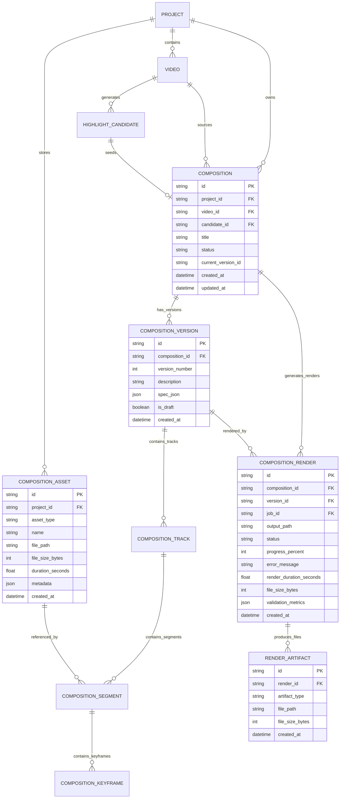

# Phase 9: Composition Engine & Rendering Pipeline
## Document 5: Database Schema & Entity-Relationship Architecture

**Document Version**: 1.0.0  
**Status**: APPROVED DESIGN (Architecture Only — No DB changes in Stage 1)  
**Author**: Principal Video Systems Architect  

---

## 1. Data Modeling Objectives

The Phase 9 data architecture must satisfy three non-negotiable operational requirements:
1. **Non-Destructive Version History**: User edits must never overwrite earlier saved compositions. Users must be able to branch, revert to previous versions, or compare iterations.
2. **Render Decoupling**: A failed render job, corrupt export, or canceled process must never corrupt or delete the editable composition specification.
3. **Cascade Deletion Integrity**: Deleting a `Project` or source `Video` must cleanly cascade through all compositions, versions, assets, and renders without leaving orphaned records or disk artifacts.

---

## 2. Entity-Relationship Diagram (ERD)

---

## 3. Detailed Entity Specifications

### 3.1 Entity: `Composition`
Represents the top-level logical composition container belonging to a project and associated with a source video.

| Column | Type | Constraints | Description |
| :--- | :--- | :--- | :--- |
| `id` | `String(36)` | PK, UUID v4 | Primary key |
| `project_id` | `String(36)` | FK -> `projects.id` ON DELETE CASCADE | Owning project |
| `video_id` | `String(36)` | FK -> `videos.id` ON DELETE CASCADE | Source video reference |
| `candidate_id` | `String(36)` | FK -> `highlight_candidates.id` ON DELETE SET NULL, Nullable | Seed highlight candidate (if created from AI highlight) |
| `title` | `String(255)` | Not Null | Display title (e.g. "Startup Pitch Highlight #1") |
| `status` | `String(50)` | Default `"draft"`, Index | `"draft"`, `"ready"`, `"rendering"`, `"exported"` |
| `current_version_id`| `String(36)` | Nullable | Pointer to currently active `CompositionVersion` |
| `created_at` | `DateTime` | UTC default | Creation timestamp |
| `updated_at` | `DateTime` | UTC on-update | Last modification timestamp |

---

### 3.2 Entity: `CompositionVersion`
Stores an immutable snapshot of the composition specification. Every major edit or manual save creates a new version number.

| Column | Type | Constraints | Description |
| :--- | :--- | :--- | :--- |
| `id` | `String(36)` | PK, UUID v4 | Primary key |
| `composition_id` | `String(36)` | FK -> `compositions.id` ON DELETE CASCADE, Index | Parent composition |
| `version_number` | `Integer` | Not Null, Index | Sequential version ($1, 2, 3, \dots$) |
| `description` | `String(255)`| Nullable | Optional changelog (e.g. "Changed to 2-person split screen") |
| `spec_json` | `JSON` | Not Null | Full validated `CompositionSpec` payload |
| `is_draft` | `Boolean` | Default `True` | `True` for autosaved working drafts, `False` for locked revisions |
| `created_at` | `DateTime` | UTC default | Version creation timestamp |

---

### 3.3 Entity: `CompositionAsset`
Manages auxiliary project assets such as B-roll clips, background music tracks, sound effects, logos, and custom watermark images.

| Column | Type | Constraints | Description |
| :--- | :--- | :--- | :--- |
| `id` | `String(36)` | PK, UUID v4 | Primary key |
| `project_id` | `String(36)` | FK -> `projects.id` ON DELETE CASCADE, Index | Owning project |
| `asset_type` | `String(50)` | Index | `"b_roll"`, `"music"`, `"sfx"`, `"logo"`, `"watermark"` |
| `name` | `String(255)` | Not Null | Original filename |
| `file_path` | `Text` | Not Null | Sanitized relative file path in project asset folder |
| `file_size_bytes` | `Integer` | Not Null | Asset file size |
| `duration_seconds`| `Float` | Nullable | Media duration (for audio/video assets) |
| `metadata` | `JSON` | Nullable | Stream metadata (dimensions, sample rate, channels) |
| `created_at` | `DateTime` | UTC default | Creation timestamp |

---

### 3.4 Entity: `CompositionRender`
Tracks export execution jobs, output media locations, and verification status.

| Column | Type | Constraints | Description |
| :--- | :--- | :--- | :--- |
| `id` | `String(36)` | PK, UUID v4 | Primary key |
| `composition_id` | `String(36)` | FK -> `compositions.id` ON DELETE CASCADE, Index | Source composition |
| `version_id` | `String(36)` | FK -> `composition_versions.id` ON DELETE CASCADE, Index | Exact version rendered |
| `job_id` | `String(36)` | FK -> `jobs.id` ON DELETE SET NULL, Nullable | Associated background Job |
| `output_path` | `Text` | Not Null | Output `.mp4` file path |
| `status` | `String(50)` | Default `"queued"`, Index | `"queued"`, `"rendering"`, `"completed"`, `"failed"`, `"cancelled"` |
| `progress_percent`| `Integer` | Default `0` | Live render progress ($0 - 100$) |
| `error_message` | `Text` | Nullable | Detailed failure diagnostics |
| `render_duration_seconds` | `Float` | Nullable | Time taken to render the export |
| `file_size_bytes` | `Integer` | Nullable | Final MP4 file size |
| `validation_metrics` | `JSON` | Nullable | Verified FFprobe stream data (duration, bitrate, codec) |
| `created_at` | `DateTime` | UTC default | Render request timestamp |

---

### 3.5 Entity: `RenderArtifact`
Captures generated sidecar files such as the burnt ASS subtitle script, intermediate thumbnail posters, and audio mix stems.

| Column | Type | Constraints | Description |
| :--- | :--- | :--- | :--- |
| `id` | `String(36)` | PK, UUID v4 | Primary key |
| `render_id` | `String(36)` | FK -> `composition_renders.id` ON DELETE CASCADE, Index | Parent render |
| `artifact_type` | `String(50)` | Index | `"ass_script"`, `"preview_thumbnail"`, `"ffscript"` |
| `file_path` | `Text` | Not Null | File path on disk |
| `file_size_bytes` | `Integer` | Not Null | File size |
| `created_at` | `DateTime` | UTC default | Creation timestamp |

---

## 4. Deletion Rules & Cascade Strategy

SQLite enforces `PRAGMA foreign_keys = ON;`. The cascade rules are designed to prevent dangling disk files and database records:
1. **Project Deletion**: Cascades to `Video`, `Composition`, `CompositionAsset`. File cleanup hooks delete the corresponding directory: `storage/clipforge_data/projects/{project_id}/`.
2. **Video Deletion**: Cascades to all associated `Composition` records.
3. **Composition Deletion**: Cascades to all `CompositionVersion`, `CompositionRender`, and `RenderArtifact` records. Export MP4 files are removed.
4. **Failed Render**: Deletes temporary filter scripts and incomplete output MP4 files without affecting `Composition` or `CompositionVersion`.

---

## 5. Migration Strategy (Phase 9 Stage 2)

When production code is introduced in Stage 2, database migrations will be handled via Alembic or synchronous SQLite DDL checks:
1. All new table creations are non-destructive to existing tables (`projects`, `videos`, `clips`, `transcripts`, `highlight_candidates`, `audio_analyses`).
2. Existing `Clip` records continue functioning for backwards compatibility with Phase 7 export.
3. A migration helper will allow one-click upgrade of existing approved `HighlightCandidate` records into new `Composition` draft records.
