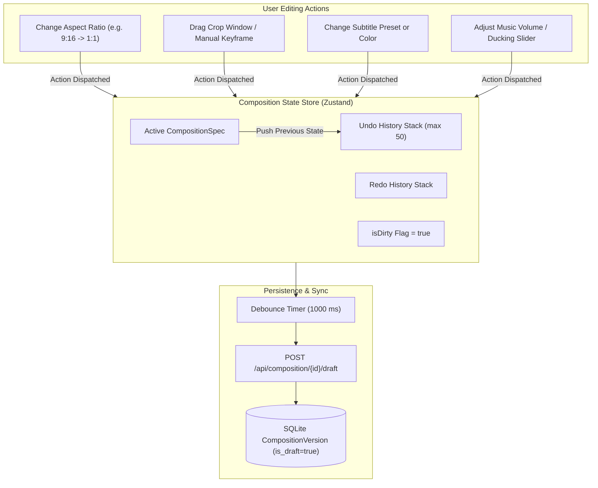

# Phase 9: Composition Engine & Rendering Pipeline
## Document 6: Frontend Composition Studio Architecture

**Document Version**: 1.0.0  
**Status**: APPROVED DESIGN (Architecture Only — No UI creation in Stage 1)  
**Author**: Senior Electron/React Lead & UI Product Engineer  

---

## 1. Audit of Existing Studio UI (`ProjectStudio.tsx`)

The existing studio UI (`src/pages/ProjectStudio.tsx`) features:
- A central video player (`VideoPlayer.tsx`) and thumbnail strip (`ThumbnailStrip.tsx`).
- A tabbed right-hand inspector with 6 separate panels:
  - `highlights`: Highlight analysis, candidate scoring, approve/reject buttons.
  - `transcript`: Transcript segments, search, word timing.
  - `vision`: Face tracking visualization, crop preview, reframe presets.
  - `subtitles`: Caption presets, subtitle editing, export modal.
  - `speakers`: Speaker turns, diarization timeline, manual associations.
  - `jobs`: Background job queue.

### Limitation of Current UI:
Each inspector panel operates as an isolated silo. There is no unified canvas where a user can adjust a 2-person split screen, view B-roll overlay cutaways, customize subtitle placement over face bounding boxes, and adjust music ducking levels in real time.

---

## 2. Proposed Phase 9 Composition Studio Layout

The Phase 9 Composition Studio transforms `ProjectStudio` into a non-linear AI video editor:

```
+----------------------------------------------------------------------------------------------------+
| Top Bar: [<- Back]  Composition: "Pitch Highlight #1"  [Aspect: 9:16 v]  [Undo] [Redo] [Export v]   |
+-----------------------------------------------------------------+----------------------------------+
|                                                                 | Inspector Tabs:                  |
|                                                                 | [Layout] [Camera] [Subs] [Audio] |
|                     Preview Canvas                              +----------------------------------+
|               (Interactive HTML5 / WebGL)                       | Layout Controls:                 |
|                                                                 | - Template: [Split Screen 50/50] |
|         +-------------------------------------+                 | - Slot 0 (Top): [Speaker 1 (Me)] |
|         | Top Safe Zone (120px)               |                 | - Slot 1 (Bot): [Speaker 2 (Guest]|
|         +-------------------------------------+                 | - Border Divider: [2px Solid]    |
|         | Slot 0: Face Track 1 (Speaker 0)    |                 |----------------------------------|
|         |                                     |                 | Camera / Framing:                |
|         | [====== Split Divider Handle ======]|                 | - Tracking: [Auto-Active Speaker]|
|         |                                     |                 | - Headroom: [---o---] 20%        |
|         | Slot 1: Face Track 2 (Speaker 1)    |                 | - Smoothing: [--o----] 85%       |
|         |  [ Subtitle: "Welcome to our pitch" ]                 | - Manual Override: [Lock Keyframe|
|         +-------------------------------------+                 |----------------------------------|
|         | Bottom Safe Zone (280px)            |                 | Audio & Ducking:                 |
|         +-------------------------------------+                 | - Dialogue: [0 dB]               |
|                                                                 | - Music Bed: [-18 dB]            |
|                                                                 | - Ducking: [X] Auto (-14 dB)     |
+-----------------------------------------------------------------+----------------------------------+
| Multi-Track Timeline: [Play/Pause]  Time: 00:04.250 / 00:30.000                                    |
| [T1: Camera Main]    |== Face Track 1 (Host) ==|=== Face Track 2 (Guest) ===|                       |
| [T2: B-Roll Cutaway]             |=== Chart Graph B-Roll ===|                                       |
| [T3: Subtitles ASS]  | "Welcome" | "to our" | "pitch today" | "we are building" |                   |
| [T4: Dialogue Audio] [==================== Waveform ===============================================]  |
| [T5: Music Bed]      [~~~~~~~~~~~~~~~~~~~~ Looped Synth Music ~~~~~~~~~~~~~~~~~~~~~~~~~~~~~~~~~~~~~~] |
+----------------------------------------------------------------------------------------------------+
```

---

## 3. Interactive Preview Canvas Architecture

### Challenge:
Rendering complex multi-input FFmpeg filtergraphs in real time during timeline scrubbing is impossible on CPU without latency.

### Solution: Dual-Mode Preview Architecture
1. **Interactive Canvas Compositor (HTML5 Canvas / CSS Transforms)**:
   - During scrubbing and real-time playback in the editor, the preview canvas compositing is handled client-side using hardware-accelerated CSS/WebGL transforms.
   - For a two-person split screen, two HTML5 `<video>` elements (or two crops from the same video element rendered to separate canvas viewports) are displayed simultaneously with smooth CSS matrix transformations.
   - Subtitles are rendered via high-performance HTML/SVG overlay matching exact ASS styling.
   - Safe-area guides (TikTok/Reels/Shorts UI overlays) are rendered with a toggleable guide layer.
2. **Proxy Fast-Render**:
   - For full-accuracy multi-layer preview, a low-resolution (360p / 540p) fast preview clip can be rendered in background on demand via `PreviewGenerator`.

---

## 4. State Management Architecture



### State Store Structure (`src/store/compositionStore.ts`):
- `spec`: Current `CompositionSpec` instance.
- `undoStack`: Array of previous `CompositionSpec` snapshots (capped at 50).
- `redoStack`: Array of undone `CompositionSpec` snapshots.
- `selectedSlot`: Currently selected layout slot ($0, 1, 2$).
- `selectedTrack`: Currently selected timeline track.
- `currentTime`: Current playback timestamp in seconds.
- `isPlaying`: Playback state boolean.
- `safeAreaVisible`: Toggle for UI safe-area overlays.
- `saveStatus`: `"saved"`, `"saving"`, `"unsaved"`.

### Undo / Redo Mechanism:
Every state change creates an immutable clone of `spec`. Pushing to `undoStack` enables instantaneous `Ctrl+Z` / `Ctrl+Y` without network latency.

### Autosave Debouncing:
When `spec` changes, a 1000ms debounce timer triggers a background HTTP PUT to save a draft version (`is_draft = True`), ensuring zero work is lost in the event of an unexpected application restart.

---

## 5. UI Component Hierarchy

```
src/components/composition/
├── CompositionStudio.tsx          (Main composition layout & coordinator)
├── canvas/
│   ├── CompositionCanvas.tsx      (Composited multi-slot preview container)
│   ├── CanvasSlot.tsx             (Individual camera crop viewport)
│   ├── SafeAreaOverlay.tsx        (Toggleable TikTok/Reels UI bounds)
│   └── CropHandleOverlay.tsx      (Interactive draggable crop window handles)
├── timeline/
│   ├── CompositionTimeline.tsx    (Multi-track timeline container)
│   ├── TimelineRuler.tsx          (Microsecond timestamp ruler with playhead)
│   ├── VideoTrackRow.tsx          (Camera tracks with speaker face badges)
│   ├── BRollTrackRow.tsx          (B-roll cutaway blocks with drag-to-trim)
│   ├── SubtitleTrackRow.tsx       (Word-level subtitle segment blocks)
│   └── AudioTrackRow.tsx          (Waveform display & volume envelopes)
├── inspector/
│   ├── CompositionInspector.tsx   (Right sidebar tabs container)
│   ├── LayoutTab.tsx              (Layout preset selector & split-screen dividers)
│   ├── CameraTab.tsx              (Face track assignment, smoothing, headroom)
│   ├── SubtitleTab.tsx            (Preset gallery, font picker, collision avoidance)
│   ├── AudioTab.tsx               (Voice gain, music picker, ducking parameters)
│   └── ExportTab.tsx              (Profile selector, bitrate, render button)
└── modals/
    ├── AssetPickerModal.tsx       (Select local B-roll videos, music, logos)
    └── RenderProgressModal.tsx    (Real-time progress, ETA, and cancellation)
```
