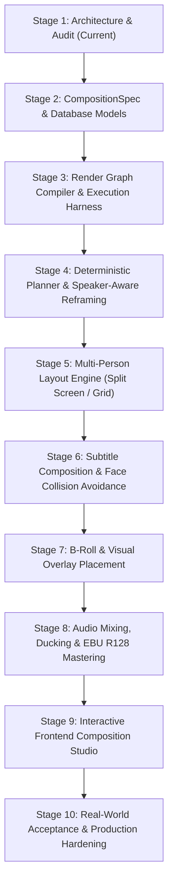

# Phase 9: Composition Engine & Rendering Pipeline
## Document 8: Dependency-Aware Implementation Roadmap

**Document Version**: 1.0.0  
**Status**: APPROVED ROADMAP  
**Author**: Principal Video Systems Architect  

---

## 1. Roadmap Overview & Strategic Dependency Ordering

Based on our architectural audit, the implementation sequence has been optimized into **10 well-defined stages**. 

Crucially, **Stage 3 builds the Render Graph Compiler & Execution Harness immediately after Stage 2's data models**. This provides an executable compiler and test harness early, allowing Stages 4 through 8 (reframing, layouts, subtitles, overlays, audio) to be verified against real FFmpeg renders rather than deferred to the end.

---

## 2. Stage-by-Stage Detailed Specifications

### Stage 1: Repository Audit, Composition Architecture & Rendering Pipeline Design *(Current Stage)*
- **Objective**: Conduct comprehensive repository audit across Phases 1–8; design unified composition specification, render graph, data model, frontend UX, and performance strategy.
- **Deliverables**: 10 comprehensive architectural documents in `docs/`. Baseline verification (187/187 tests passing, clean builds).
- **Source Files**: `docs/PHASE9_*.md`.
- **Dependencies**: None.
- **Acceptance Criteria**: All 10 documents authored; zero production code modified; strict stop condition observed.

---

### Stage 2: Unified Composition Specification & Versioned Database Models
- **Objective**: Implement versioned Pydantic schemas for `CompositionSpec` (v1.0.0) and SQLAlchemy persistence entities (`Composition`, `CompositionVersion`, `CompositionAsset`, `CompositionRender`).
- **Deliverables**:
  - `backend/app/schemas/composition_schemas.py`
  - `backend/app/db/models.py` (updated with Phase 9 entities)
  - `backend/app/services/composition_service.py` (CRUD, versioning, draft autosave)
  - REST API endpoints under `/api/composition`
- **Dependencies**: Stage 1.
- **Acceptance Criteria**: Full CRUD operations for compositions; creating new versions preserves previous snapshots; cascade deletions verified in SQLite.
- **Automated Tests**: Unit tests covering Pydantic validation, serialization roundtrips, foreign key cascades, and draft vs approved versioning.
- **Failure Conditions**: Data loss on edit; broken foreign key cascades; schema validation errors.

---

### Stage 3: Render Graph Compiler & Modular FFmpeg Execution Harness
- **Objective**: Implement the DAG-based `RenderGraphCompiler` that translates a `CompositionSpec` into a modular FFmpeg command array and temporary `-filter_complex_script` files, with `CapabilityDetector` preflight checks.
- **Deliverables**:
  - `backend/app/video/render_graph_compiler.py`
  - `backend/app/video/render_nodes.py` (modular video/audio DAG nodes)
  - `backend/app/services/composition_render_service.py`
- **Dependencies**: Stage 2.
- **Acceptance Criteria**: Compiles valid FFmpeg argument arrays across all aspect ratios (9:16, 1:1, 4:5, 16:9); tests NVENC capability before use with automatic CPU libx264 fallback; parses progress; supports cooperative cancellation within 1.0s.
- **Automated Tests**: Filtergraph syntax validation tests, stream label connectivity tests, cancellation tests, and hardware fallback tests.
- **Failure Conditions**: Subprocess command syntax error; Windows command line length truncation; unhandled cancellation.

---

### Stage 4: Deterministic Composition Planner & Speaker-Aware Reframing
- **Objective**: Implement `CompositionPlanner` to automatically convert approved `HighlightCandidate` records into production `CompositionSpec` instances, binding Phase 8 `ActiveSpeakerInterval` and Phase 6 `FaceTrack` data to camera keyframes.
- **Deliverables**:
  - `backend/app/services/composition_planner.py`
  - `backend/app/ai/vision/camera_reframe_planner.py`
- **Dependencies**: Stage 3.
- **Acceptance Criteria**: Seamless transition from approved highlight to editable composition; camera keyframes track active speaker with EMA smoothing and 1.2s minimum hold times; zero camera jitter during low-confidence speech.
- **Automated Tests**: Benchmark dialogues with alternating speakers; checks transition types (`cut` vs `smooth_pan`), headroom clamping, and fallback behavior.
- **Real-Media Acceptance**: End-to-end render of an 8.0s dialogue video verifying subject centering.

---

### Stage 5: Multi-Person Layout Engine (Split-Screen & Grids)
- **Objective**: Implement layout compilation for multi-person layouts: vertical 50/50 split-screen, 3-person grid, picture-in-picture, and 16:9 centered with blurred background.
- **Deliverables**:
  - `backend/app/video/layout_engine.py`
  - Layout compilation nodes inside `render_nodes.py` (`vstack`, `hstack`, `xstack`, `boxblur`)
- **Dependencies**: Stage 4.
- **Acceptance Criteria**: Clean vertical split-screen rendering with two distinct face tracks; zero aspect ratio distortion; blurred-background rendering for landscape footage.
- **Automated Tests**: Geometry assertions verifying slot bounds, even pixel dimensions, and filtergraph generation for all 7 layout types.
- **Real-Media Acceptance**: Render 2-person interview into 9:16 vertical split screen (Host top, Guest bottom).

---

### Stage 6: Broadcast Subtitle Composition & Face Collision Avoidance
- **Objective**: Integrate Phase 7 ASS subtitle generation into the `CompositionSpec` with dynamic face-bounding-box collision avoidance and speaker-specific color coding.
- **Deliverables**:
  - `backend/app/services/subtitle_composition_engine.py`
  - Collision detection logic between subtitle bounding box and face tracks
- **Dependencies**: Stage 5.
- **Acceptance Criteria**: Subtitles automatically burned into render graph via `ass` filter; if face bounding box enters bottom safe area, subtitles automatically adjust upward into safe active area; word-level karaoke synchronization verified.
- **Automated Tests**: Word-timing offset tests, ASS escaping tests, and bounding-box collision avoidance tests.
- **Real-Media Acceptance**: Render video with animated karaoke captions verifying zero mouth/face occlusion.

---

### Stage 7: B-Roll & Visual Overlay Composition
- **Objective**: Implement multi-layer visual overlays for cutaway footage, picture-in-picture clips, channel logos, and watermarks with time-windowed `overlay=enable='between(t,...)'` scheduling.
- **Deliverables**:
  - `backend/app/services/overlay_planner.py`
  - B-roll asset ingestion and duration validation
- **Dependencies**: Stage 6.
- **Acceptance Criteria**: B-roll cutaway smoothly cuts in and out at exact specified timestamps; main vocal audio continues uninterrupted during muted B-roll; logos and watermarks positioned in safe areas.
- **Automated Tests**: Multi-input FFmpeg DAG tests, timestamp alignment tests, missing asset error handling.
- **Real-Media Acceptance**: Render a 15s clip with a 4s B-roll video cutaway and corner channel logo.

---

### Stage 8: Audio Mixing, Voice Ducking & EBU R128 Mastering
- **Objective**: Implement multi-track audio mixing engine with background music beds, automated sidechain compression ducking against vocals, and final EBU R128 loudness normalization (-14 LUFS, -1.0 dBTP).
- **Deliverables**:
  - `backend/app/video/audio_mix_planner.py`
  - Audio filtergraph compiler (`atrim`, `sidechaincompress`, `amix`, `loudnorm`, `alimiter`)
- **Dependencies**: Stage 7.
- **Acceptance Criteria**: Background music volume automatically attenuates by 14 dB within 50 ms of vocal speech onset; recovers within 350 ms of silence; final audio integrated loudness measures $-14.0 \pm 1.0$ LUFS with true peak $\le -1.0$ dBTP.
- **Automated Tests**: Audio filter syntax tests, ducking trigger tests, loudness compliance verification via FFprobe `ebur128`.
- **Real-Media Acceptance**: Render clip with dialogue + background music bed, verifying crisp vocal clarity and audible ducking.

---

### Stage 9: Interactive Frontend Composition Studio
- **Objective**: Build the React/TypeScript Composition Studio UI in `src/components/composition/` with interactive multi-slot canvas, aspect ratio switcher, multi-track timeline, inspector panels, undo/redo, and live WebSocket render progress.
- **Deliverables**:
  - `src/components/composition/*` (Canvas, Timeline, Inspector, Modals)
  - `src/store/compositionStore.ts` (Zustand state store with undo/redo)
  - `src/pages/ProjectStudio.tsx` (Integrated composition tab)
- **Dependencies**: Stage 8.
- **Acceptance Criteria**: Clean UI compiling with `tsc -p tsconfig.electron.json` and Vite; aspect ratio switching updates canvas instantly; timeline scrubbing smoothly syncs video; undo/redo restores previous state; render progress modal displays real-time percentage and ETA.
- **Automated Tests**: React component unit tests, state store transition tests.
- **Real-Media Acceptance**: End-to-end user workflow: select approved highlight, adjust crop, choose split screen, tweak subtitle preset, and trigger export from UI.

---

### Stage 10: Real-World Acceptance, Benchmark Integrity & Production Hardening
- **Objective**: Conduct rigorous end-to-end benchmark integrity verification across 20 diverse real-world video scenarios (solo, podcast dialogue, multi-person panel, landscape lecture, gaming clip).
- **Deliverables**:
  - Benchmark evaluation script: `backend/tests/benchmark_phase9_compositions.py`
  - Formal reports: `docs/PHASE9_FINAL_ACCEPTANCE_REPORT.md`
- **Dependencies**: Stage 9.
- **Acceptance Criteria**: 100% of benchmark compositions render and pass FFprobe validation; RTF on CPU $< 2.0x$ (or $< 0.8x$ on RTX 4060); peak RAM $< 2.5$ GB; zero memory leaks across consecutive renders; 100% regression suite passing.
