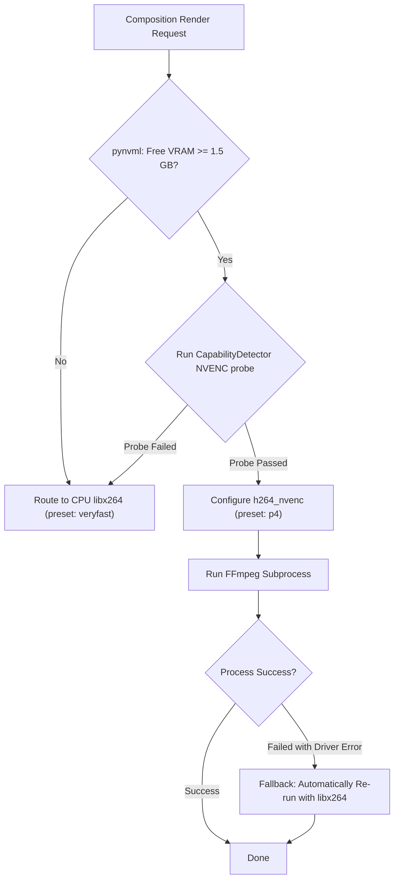

# Phase 9: Composition Engine & Rendering Pipeline
## Document 7: Performance, Concurrency & Hardware Optimization Strategy

**Document Version**: 1.0.0  
**Status**: APPROVED STRATEGY  
**Author**: Senior Systems Architect & Performance Specialist  

---

## 1. Target Hardware Constraints

ClipForge AI runs locally on consumer workstation and laptop hardware:
- **CPU**: Intel Core i7-13620H (6 Performance Cores + 4 Efficient Cores, 16 threads, up to 4.90 GHz)
- **RAM**: 16 GB DDR5 5200 MHz
- **GPU**: NVIDIA GeForce RTX 4060 Laptop GPU (8 GB GDDR6 VRAM)
- **Storage**: PCIe Gen 4 NVMe SSD (Read/Write $> 3500$ MB/s)
- **Operating System**: Windows 11 (64-bit)

### Operational Principle:
The application **must remain fully responsive** (interactive UI scrubbing, window moving, audio playback) while an intensive background composition rendering job is executing.

---

## 2. Memory Budgeting & Bounded Processing

```
+-----------------------------------------------------------------------+
| 16 GB Total System RAM Budget                                         |
+------------------------------------+----------------------------------+
| Windows OS & Core Services:        | 4.5 GB                           |
| Electron App & React Renderer:     | 1.0 GB                           |
| FastAPI Backend Process (Baseline):| 0.2 GB                           |
| Loaded AI Models (ONNX / Whisper): | 1.8 GB (Sequential execution)   |
| FFmpeg Filtergraph Decoding/Buffer:| 2.5 GB (Bounded multi-stream)    |
| Free System Headroom / OS Caching: | 6.0 GB                           |
+------------------------------------+----------------------------------+
```

### Memory Rules:
1. **No In-Memory Uncompressed Video Buffering**:
   - 10 seconds of uncompressed 1080x1920 24 fps RGBA video requires:
     $$10 \text{ s} \times 24 \text{ fps} \times 1080 \times 1920 \times 4 \text{ bytes} \approx 1.99 \text{ GB RAM}$$
   - Loading complete video clips into Python memory lists is strictly prohibited. All video framing, scaling, and compositing must occur inside FFmpeg's native streaming C pipeline via `filter_complex`.
2. **Chunked Generator Processing**:
   - AI analysis (landmarks, lip dynamics, face tracking) must continue executing in **25-frame streaming chunks** (1.0 second), discarding image crops immediately to keep incremental RAM $< 120$ MB.
3. **Pre-Flight Disk Space Verification**:
   - Before launching an export render, `RenderGraphCompiler` calculates required disk space:
     $$\text{Estimated Bytes} = \text{duration\_sec} \times \frac{\text{bitrate\_kbps} \times 1000}{8} \times 1.50 \text{ (headroom factor)}$$
   - If free disk space on the target volume is $< 2.0$ GB or less than the estimated requirement, the job aborts immediately with an informative user error.

---

## 3. CPU Thread Budgeting & Concurrency Control

The Intel Core i7-13620H has 16 logical execution threads. Unconstrained FFmpeg or ONNX execution can easily saturate all 16 threads, causing UI stuttering and audio playback crackles.

### Thread Allocation Matrix:

| Process / Task | Logical Cores Allocated | Affinity / Priority | Rationale |
| :--- | :--- | :--- | :--- |
| **Electron Main & UI Renderer** | 2 Cores | Normal Priority | Preserves 60 FPS UI rendering and smooth playback scrubbing. |
| **FastAPI Backend Server** | 2 Cores | Normal Priority | Ensures instantaneous REST and WebSocket response times. |
| **FFmpeg Rendering (libx264)** | **6 to 8 Threads** | `BELOW_NORMAL_PRIORITY_CLASS` | Uses `-threads 8` in FFmpeg args. Caps CPU utilization at ~60-70%, leaving headroom for system responsiveness. |
| **ONNX Runtime (Light-ASD/CAM++)** | **4 Threads** | Sequential Mode | `intra_op_num_threads = 4`, `inter_op_num_threads = 1`. |

```python
# Windows process priority setting in FFmpegManager for render jobs:
if os.name == "nt":
    creationflags = subprocess.BELOW_NORMAL_PRIORITY_CLASS
```

---

## 4. GPU Acceleration & VRAM Headroom Protection

### RTX 4060 Laptop (8 GB VRAM) Constraints:
- NVIDIA consumer desktop and mobile drivers enforce a hardware session limit on concurrent NVENC streams (up to 5 concurrent sessions).
- If another application (e.g. game, 3D software, or browser hardware acceleration) occupies VRAM, NVENC initialization can fail with `CUDA_ERROR_OUT_OF_MEMORY`.

### Pre-Render Capability Gate:


---

## 5. Preview Generation vs Final Export Strategy

| Attribute | Interactive Preview Canvas | Low-Res Proxy Fast-Render | Final Master Export |
| :--- | :--- | :--- | :--- |
| **Execution Engine** | React Canvas / CSS Transforms | FFmpeg (Ultrafast preset) | FFmpeg (P4 NVENC or libx264 CRF 20) |
| **Resolution** | Native Viewport (e.g. 360x640) | 540x960 | 1080x1920 (or target output) |
| **Framerate** | Native Browser (60 fps) | 24 / 30 fps | 30.0 / 60.0 fps |
| **Latency / RTF** | **0.00x (Instantaneous)** | ~0.15x (Fast) | 0.89x – 1.67x (High quality) |
| **Audio Processing** | Web Audio API / HTML5 Audio | Simple AAC mix | Broadcast EBU R128 + Ducking |
| **Subtitles** | SVG / HTML text overlay | Burned ASS | Burned broadcast-grade ASS |
| **Persistence** | In-memory React state | Temporary cache folder | Project export folder (`.mp4`) |

---

## 6. Temporary File Cleanup & Disk Hygiene

Rendering multi-layer compositions produces temporary intermediate assets:
- ASS subtitle files (`clipforge_sub_{id}.ass`).
- FFmpeg filtergraph scripts (`filtergraph_{id}.ffscript`).
- Transcoded audio scratch files (`temp_ducked_{id}.wav`).

### Cleanup Lifecycle:
1. All temporary files are created under a deterministic per-job directory:
   `storage/clipforge_data/cache/render_jobs/{job_id}/`
2. Upon job completion (whether **succeeded**, **failed**, or **cancelled**), a `finally` block in `CompositionRenderService` purges the directory:
   ```python
   try:
       await execute_render_pipeline(...)
   finally:
       cleanup_job_scratch_dir(job_id)
   ```
3. An application startup hook cleans any orphaned scratch directories older than 24 hours.
