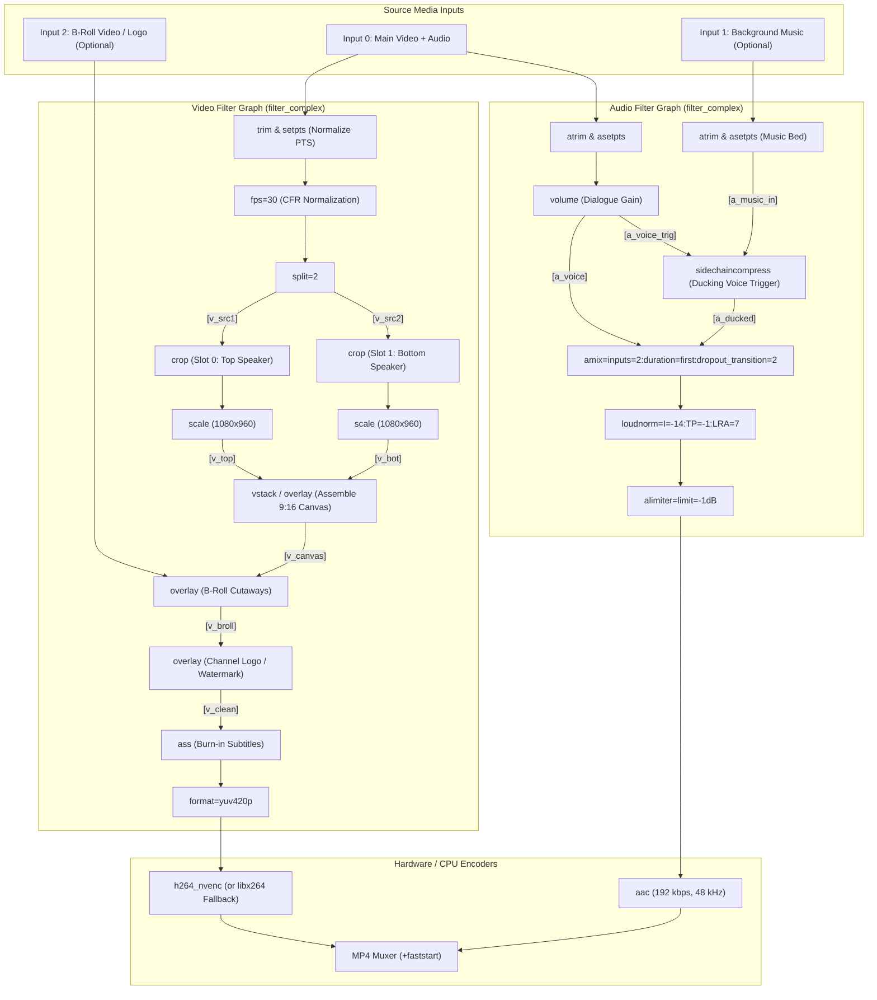
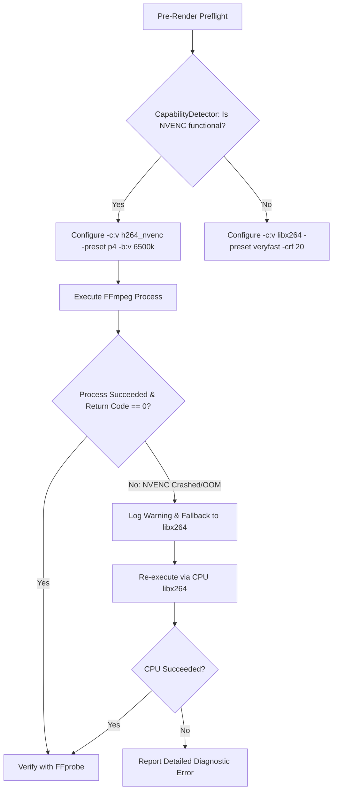

# Phase 9: Composition Engine & Rendering Pipeline
## Document 4: Render Graph Compiler & FFmpeg Pipeline Design

**Document Version**: 1.0.0  
**Status**: APPROVED DESIGN  
**Author**: FFmpeg Specialist & Video Systems Architect  

---

## 1. Architectural Strategy: From Monolithic Strings to Filter DAGs

In Phase 7, video rendering relied on string concatenation inside `-vf`:
```python
# Phase 7 legacy approach (fragile, single stream only):
vf_full = f"{vf_base},ass=filename='{clean_ass_path}'"
```

This monolithic pattern fails when introducing:
- Multi-speaker layouts (requiring multi-output branching with `split` and stacking with `xstack` or `overlay`).
- Picture-in-picture and B-roll cutaways (requiring secondary video streams with alpha transparency or time-ranged insertion).
- Multi-track audio mixing and sidechain ducking (requiring `-filter_complex` rather than `-vf`).

Phase 9 introduces the **Modular Render Graph Compiler**. It treats FFmpeg filtergraphs as a **Directed Acyclic Graph (DAG)** of typed, validated nodes. Each node declares explicit input stream labels and output stream labels.



---

## 2. Stream Labeling Nomenclature

To eliminate collision and ensure complete auditability, stream labels adhere to strict prefixed naming:

| Prefix | Domain | Description | Example |
| :--- | :--- | :--- | :--- |
| `[v_in_N]` | Video Input | Normalized, trimmed source video input stream | `[v_in_0]`, `[v_in_1]` |
| `[v_crop_S]` | Video Layout | Crop output for layout slot $S$ | `[v_crop_0]`, `[v_crop_1]` |
| `[v_slot_S]` | Video Layout | Scaled, positioned video layer for slot $S$ | `[v_slot_0]`, `[v_slot_1]` |
| `[v_canvas]` | Video Layout | Base composite canvas combining all layout slots | `[v_canvas]` |
| `[v_broll]` | Video Overlay | Composite after B-roll insertion | `[v_broll]` |
| `[v_graphic]` | Video Overlay | Composite after logo/watermark overlay | `[v_graphic]` |
| `[v_subs]` | Video Subtitles | Video stream after ASS subtitle burn-in | `[v_subs]` |
| `[v_out]` | Video Master | Final video stream routed to video encoder | `[v_out]` |
| `[a_voice]` | Audio Speech | Normalized, trimmed voice audio stream | `[a_voice]` |
| `[a_music]` | Audio Music | Background music bed | `[a_music]` |
| `[a_ducked]` | Audio Music | Music bed after sidechain compression | `[a_ducked]` |
| `[a_mix]` | Audio Master | Mixed voice + ducked music | `[a_mix]` |
| `[a_out]` | Audio Master | Final mastered, EBU R128 normalized audio stream | `[a_out]` |

---

## 3. Evaluated Filter Nodes & Exact Parameter Formulations

### 3.1 PTS Normalization & CFR Conversion
Mobile and web source videos frequently utilize variable frame rates (VFR) or non-zero presentation timestamps (PTS), causing audio-video drift when trimmed.
```ffmpeg
[0:v]trim=start=10.500:end=40.500,setpts=PTS-STARTPTS,fps=fps=30.000:round=near[v_in_0];
[0:a]atrim=start=10.500:end=40.500,asetpts=PTS-STARTPTS[a_voice_raw]
```

### 3.2 Dynamic Crop & Scale (Single Speaker Layout)
For smooth pan trajectories, coordinates are updated via piecewise linear interpolation:
```ffmpeg
[v_in_0]crop=w=608:h=1080:x='if(lt(t,1.5),120+(240-120)*(t-0.0)/1.5,240)':y=0,scale=1080:1920:flags=bicubic[v_canvas]
```

### 3.3 Two-Person Split Screen (`split_screen_vertical_2`)
Top slot (Speaker 1, 1080x960), Bottom slot (Speaker 2, 1080x960):
```ffmpeg
[v_in_0]split=2[v_branch_0][v_branch_1];
[v_branch_0]crop=w=608:h=540:x=100:y=120,scale=1080:960:flags=bicubic[v_slot_0];
[v_branch_1]crop=w=608:h=540:x=900:y=120,scale=1080:960:flags=bicubic[v_slot_1];
[v_slot_0][v_slot_1]vstack=inputs=2[v_canvas]
```

### 3.4 16:9 Landscape Centered on Blurred Background (`landscape_blurred_bg`)
```ffmpeg
[v_in_0]split=2[v_sharp][v_blur_in];
[v_blur_in]scale=1080:1920:force_original_aspect_ratio=increase,crop=1080:1920,boxblur=luma_radius=30:luma_power=2[v_bg];
[v_sharp]scale=1080:608:flags=bicubic[v_fg];
[v_bg][v_fg]overlay=x=0:y=(H-h)/2[v_canvas]
```

### 3.5 B-Roll Overlay with Time Windowing
```ffmpeg
[1:v]trim=start=0.0:end=5.0,setpts=PTS-STARTPTS,scale=1080:1920:flags=bicubic[v_broll_in];
[v_canvas][v_broll_in]overlay=x=0:y=0:enable='between(t,3.5,8.5)'[v_broll]
```

### 3.6 Advanced SubStation Alpha Subtitle Burn-In
Windows file paths with drive letters (`C:\...`) require colon and backslash escaping for FFmpeg's `ass` filter:
```ffmpeg
[v_broll]ass=filename='C\:/Users/yogac/AppData/Local/Temp/clipforge_sub_4f2b1c.ass'[v_subs]
```

### 3.7 Audio Sidechain Compression Ducking
Ducks background music whenever vocal speech is present:
- Threshold: `-30dB`
- Ratio: `4:1`
- Attack: `50ms`
- Release: `350ms`
- Makeup Gain: `1.0`
```ffmpeg
[a_music_in][a_voice_trig]sidechaincompress=threshold=0.0316:ratio=4:attack=50:release=350:makeup=1[a_ducked];
[a_voice][a_ducked]amix=inputs=2:duration=first:dropout_transition=2[a_mix]
```

### 3.8 Broadcast EBU R128 Loudness Normalization & True-Peak Limiter
Normalizes overall audio to social media standards (-14 LUFS, -1.0 dBTP):
```ffmpeg
[a_mix]loudnorm=I=-14.0:TP=-1.0:LRA=7.0:measured_I=-24.0:measured_TP=-2.0:measured_LRA=8.0:print_format=summary,alimiter=limit=-1.0dB[a_out]
```

---

## 4. Windows Command Line Limits & Script Handling

### Problem:
On Windows 11, the maximum command-line string length for a spawned subprocess in the Win32 API is **32,767 characters**. A 60-second composition with multi-keyframe trajectory equations, multiple overlay clips, and audio mixing can easily exceed 40,000 characters if passed via `-filter_complex "..."`.

### Solution: Dedicated `-filter_complex_script` File
When compiling the render graph:
1. `RenderGraphCompiler` evaluates the total character length of the generated filter graph.
2. If total filter length $> 2,048$ characters or if the composition contains multi-camera layouts, the compiler writes the filter graph to a temporary file:
   `storage/clipforge_data/cache/render_scripts/filtergraph_{composition_id}.ffscript`
3. The FFmpeg argument array is constructed cleanly:
   ```python
   args = [
       "-y",
       "-i", source_video_path,
       *(["-i", music_path] if music_path else []),
       *(["-i", broll_path] if broll_path else []),
       "-filter_complex_script", str(script_file_path),
       "-map", "[v_out]",
       "-map", "[a_out]",
       *encoder_args,
       str(output_path)
   ]
   ```
4. This completely avoids command line truncation, escaping bugs, and shell injection.

---

## 5. Hardware Acceleration Strategy & Automatic CPU Fallback

ClipForge AI strictly tests encoder hardware capabilities prior to job invocation:



This guarantees 100% render reliability even if NVIDIA GPU drivers fail, GPU memory is exhausted, or the app runs on a machine without dedicated graphics.
