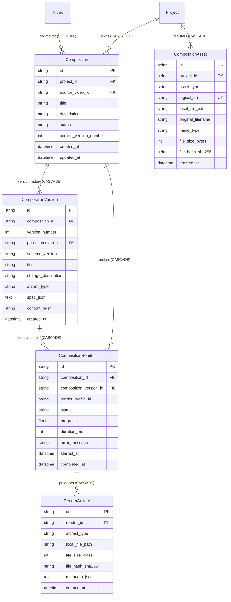

# Phase 9 Stage 2: Versioned Database Implementation

## 1. Overview

Phase 9 Stage 2 introduces a persistent, versioned, non-destructive data model for compositions within ClipForge AI's existing SQLite database. The schema ensures:
- **Append-only Version Snapshots**: Every edit to a composition produces a new version record. Previous versions remain immutable.
- **Optimistic Concurrency Control (OCC)**: Concurrent editing conflicts are caught using version sequencing (`expected_version_number`), preventing dirty writes.
- **Project-Scoped Asset Authorization**: Media assets used in a composition must be registered and verified against the owning project.
- **Cascading Integrity**: Deletion of a Project cascades to Compositions, Versions, and Renders. Foreign keys are strictly enforced via SQLite PRAGMA.

---

## 2. Entity Relationship Diagram (ERD)



---

## 3. Database Schema Definitions

### 3.1 `compositions` Table
Represents the mutable logical container of an edit.
```sql
CREATE TABLE compositions (
    id VARCHAR PRIMARY KEY,
    project_id VARCHAR NOT NULL REFERENCES projects(id) ON DELETE CASCADE,
    source_video_id VARCHAR REFERENCES videos(id) ON DELETE SET NULL,
    title VARCHAR NOT NULL,
    description VARCHAR,
    status VARCHAR DEFAULT 'draft',
    current_version_number INTEGER DEFAULT 1,
    created_at DATETIME DEFAULT CURRENT_TIMESTAMP,
    updated_at DATETIME DEFAULT CURRENT_TIMESTAMP
);
CREATE INDEX ix_compositions_project_id ON compositions(project_id);
```

### 3.2 `composition_versions` Table
Immutable snapshots of the complete `CompositionSpec` AST.
```sql
CREATE TABLE composition_versions (
    id VARCHAR PRIMARY KEY,
    composition_id VARCHAR NOT NULL REFERENCES compositions(id) ON DELETE CASCADE,
    version_number INTEGER NOT NULL,
    parent_version_id VARCHAR REFERENCES composition_versions(id) ON DELETE SET NULL,
    schema_version VARCHAR DEFAULT '1.0.0',
    title VARCHAR NOT NULL,
    change_description VARCHAR,
    author_type VARCHAR DEFAULT 'user',
    spec_json TEXT NOT NULL,
    content_hash VARCHAR NOT NULL,
    created_at DATETIME DEFAULT CURRENT_TIMESTAMP,
    CONSTRAINT uq_comp_version UNIQUE (composition_id, version_number)
);
CREATE INDEX ix_composition_versions_comp_version ON composition_versions(composition_id, version_number);
```

### 3.3 `composition_assets` Table
Project-scoped registry mapping logical URIs (`asset://videos/vid_01`) to physical storage paths.
```sql
CREATE TABLE composition_assets (
    id VARCHAR PRIMARY KEY,
    project_id VARCHAR NOT NULL REFERENCES projects(id) ON DELETE CASCADE,
    asset_type VARCHAR NOT NULL,
    logical_uri VARCHAR NOT NULL,
    local_file_path VARCHAR NOT NULL,
    original_filename VARCHAR NOT NULL,
    mime_type VARCHAR,
    file_size_bytes INTEGER DEFAULT 0,
    file_hash_sha256 VARCHAR,
    created_at DATETIME DEFAULT CURRENT_TIMESTAMP,
    CONSTRAINT uq_project_asset UNIQUE (project_id, logical_uri)
);
CREATE INDEX ix_composition_assets_project_uri ON composition_assets(project_id, logical_uri);
```

### 3.4 `composition_renders` Table
Tracks asynchronous background rendering jobs.
```sql
CREATE TABLE composition_renders (
    id VARCHAR PRIMARY KEY,
    composition_id VARCHAR NOT NULL REFERENCES compositions(id) ON DELETE CASCADE,
    composition_version_id VARCHAR NOT NULL REFERENCES composition_versions(id) ON DELETE CASCADE,
    render_profile_id VARCHAR,
    status VARCHAR DEFAULT 'pending',
    progress FLOAT DEFAULT 0.0,
    duration_ms INTEGER,
    error_message VARCHAR,
    started_at DATETIME,
    completed_at DATETIME
);
```

### 3.5 `render_artifacts` Table
Stores rendered output binaries, diagnostic logs, and exported preview assets.
```sql
CREATE TABLE render_artifacts (
    id VARCHAR PRIMARY KEY,
    render_id VARCHAR NOT NULL REFERENCES composition_renders(id) ON DELETE CASCADE,
    artifact_type VARCHAR NOT NULL,
    local_file_path VARCHAR NOT NULL,
    file_size_bytes INTEGER DEFAULT 0,
    file_hash_sha256 VARCHAR,
    metadata_json TEXT,
    created_at DATETIME DEFAULT CURRENT_TIMESTAMP
);
```

---

## 4. Concurrency & Non-Destructive Versioning

### 4.1 Optimistic Concurrency Control (OCC)
When updating a composition:
1. Client submits edit along with `expected_version_number`.
2. `CompositionVersionService` checks if `composition.current_version_number == expected_version_number`.
3. If unequal, an `OptimisticConcurrencyError` (HTTP 409 Conflict) is raised. The client must re-fetch the latest version before applying edits.
4. If matched, a new `CompositionVersion` row is created with `version_number = current_version_number + 1`.
5. `composition.current_version_number` is updated atomically.

### 4.2 Non-Destructive Version Restoration
Restoring an earlier version (e.g. Version 2 when current is Version 5) does **not** erase versions 3, 4, or 5:
- It creates a brand-new **Version 6** containing the exact `spec_json` payload from Version 2.
- The `parent_version_id` references Version 5, and the `change_description` records: `"Restored from version 2"`.
- This ensures an unbroken linear audit history.

---

## 5. Foreign Key Integrity in SQLite
SQLite defaults to foreign keys disabled. ClipForge AI enforces foreign keys at two levels:
1. In `backend/app/core/database.py`, an event listener triggers `PRAGMA foreign_keys = ON;` on every DBAPI connection checkout.
2. In `init_db()`, `PRAGMA foreign_keys = ON;` is executed directly upon database initialization.
