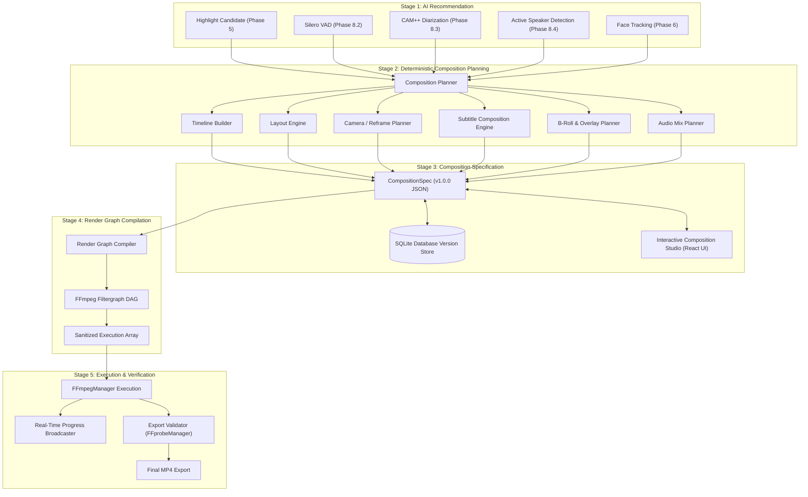
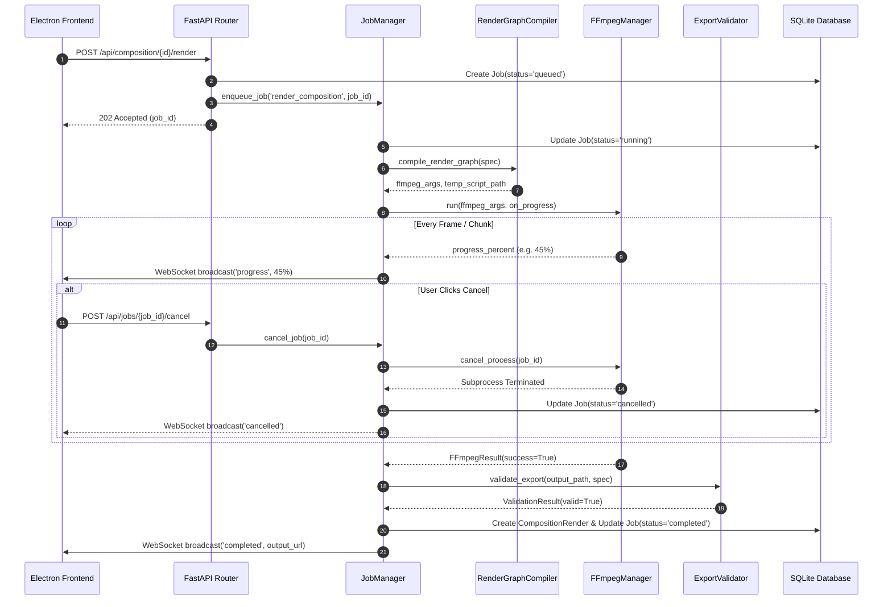

# Phase 9: Composition Engine & Rendering Pipeline
## Document 3: System Architecture & Component Specification

**Document Version**: 1.0.0  
**Status**: APPROVED ARCHITECTURE  
**Author**: Principal Video Systems Architect  

---

## 1. Architectural Philosophy: Staged & Deterministic Compilation

ClipForge AI Phase 9 adopts a **compiler-style pipeline**. Just as a software compiler parses source code into an intermediate AST and optimizes it into target machine code, ClipForge AI separates:
1. **AI Recommendations**: Non-deterministic heuristic or neural models proposing clip boundaries, speaker identities, and framing.
2. **Composition Specification (AST)**: A versioned, declarative JSON representation of the final video edit.
3. **Render Graph Compiler**: A deterministic compiler that lowers the `CompositionSpec` into a directed acyclic graph (DAG) of FFmpeg filter operations and encode commands.
4. **Execution & Validation**: Safe, cancelable process execution producing verified broadcast media.

---

## 2. Component Specifications

### 2.1 Component A: Composition Planner (`CompositionPlanner`)
- **Responsibility**: Inspects an approved `HighlightCandidate` and seeds an initial, production-grade `CompositionSpec`. Decides default aspect ratio, initial multi-camera or single-camera layout, and configures tracks.
- **Inputs**:
  - `HighlightCandidate` (start time, end time, duration, title).
  - `Video` record (source dimensions, fps, audio channels).
  - Target aspect ratio preference (e.g., `9:16`).
- **Outputs**: Initialized draft `CompositionSpec` instance.
- **Dependencies**: Database models (`HighlightCandidate`, `Video`), `ReframePreset`.
- **Error Handling**: Falls back to `center_crop` if no AI tracks or faces exist.
- **Cancellation**: Synchronous; instant.
- **Test Strategy**: Unit tests verifying that valid specs are constructed with proper boundary clamping.

---

### 2.2 Component B: Timeline Builder (`TimelineBuilder`)
- **Responsibility**: Translates source-relative timestamps into clip-relative space ($t_{\text{clip}} = t_{\text{src}} - t_{\text{start}}$). Resolves variable frame rate (VFR) timestamps to a strict constant frame rate grid (e.g., exactly 30.000 fps).
- **Inputs**: Source start/end timestamps, nominal output framerate, FFprobe frame rate metadata.
- **Outputs**: Normalized `Timeline` structure with microsecond-precision anchors.
- **Dependencies**: `FFprobeManager`.
- **Error Handling**: Detects timestamp jitter ($|PTS_{i} - PTS_{i-1}| < 0$); logs warning and inserts `setpts=PTS-STARTPTS` filter.
- **Cancellation**: Synchronous; instant.
- **Test Strategy**: Tests with synthetic VFR timestamp sequences verifying monotonic progression.

---

### 2.3 Component C: Layout Engine (`LayoutEngine`)
- **Responsibility**: Computes geometric spatial partitions (slots) across the target output canvas based on `layout_type`. Calculates pixel and normalized coordinates for 1-speaker, 2-speaker vertical split, 3-person grid, and blurred-background framing.
- **Inputs**: `layout_type`, target resolution (`width`, `height`), safe area margins.
- **Outputs**: List of `LayoutSlot` instances with normalized bounds `[x, y, w, h]` and safe-zone clipping.
- **Dependencies**: `AspectRatioProcessor`.
- **Error Handling**: Clamps slots to safe canvas boundaries $[0.0, 1.0]$; guarantees even pixel dimensions for video encoder compliance.
- **Cancellation**: Synchronous.
- **Test Strategy**: Geometry unit tests verifying zero overlap, even pixel dimensions, and boundary compliance across all layout topologies.

---

### 2.4 Component D: Camera & Reframe Planner (`CameraReframePlanner`)
- **Responsibility**: Binds active speakers and face tracks to specific layout slots. Generates smooth crop trajectories using exponential moving averages (EMA) and decides camera transitions (cuts vs smooth pans).
- **Inputs**:
  - `LayoutSlot` definitions.
  - `FaceTrack` detections from Phase 6.
  - `ActiveSpeakerInterval` records from Phase 8.
  - `SpeakerFaceAssociation` map from Phase 8.
  - User `ManualCropOverride` keyframes.
- **Outputs**: Sequence of `CameraKeyframe` items with crop bounds, transition types, and transition durations.
- **Dependencies**: `ReframeEngine`, `ActiveSpeakerService`.
- **Rule of Stability**:
  - When active-speaker confidence is low ($< 0.50$), camera remains locked on current framing; does not jitter or swing wildly.
  - Minimum hold duration: Once camera cuts to a speaker, it holds for a minimum of $1.2$ seconds before cutting again, avoiding disorienting hyperactive cuts.
- **Error Handling**: Graceful fallback to static centroid crop if face tracking is lost.
- **Cancellation**: Synchronous.
- **Test Strategy**: Synthetic multi-turn dialogues checking hold times, smoothing, and transition types.

---

### 2.5 Component E: Subtitle Composition Engine (`SubtitleCompositionEngine`)
- **Responsibility**: Ingests word-level transcript segments, clips them to composition boundaries, offsets word timestamps to $t_{\text{clip}}$, applies ASS style presets, performs collision avoidance against face bounding boxes, and writes the broadcast `.ass` script.
- **Inputs**: `Transcript` segments, `CaptionPreset`, face bounding boxes, canvas dimensions.
- **Outputs**: Fully formatted `.ass` subtitle file on disk ready for FFmpeg burn-in.
- **Dependencies**: `SubtitleRenderer`, `SubtitleService`.
- **Collision Avoidance**: If subtitle bounding box intersects a speaker's mouth or chin, shifts vertical margin `margin_v` upward into safe active content area.
- **Error Handling**: Fallback to standard bottom-safe placement if collision calculation fails.
- **Cancellation**: Synchronous; completes in $< 20$ ms.
- **Test Strategy**: Asserts word-by-word timing consistency, text escaping, and position adjustments.

---

### 2.6 Component F: B-Roll & Overlay Planner (`OverlayPlanner`)
- **Responsibility**: Manages cutaways, picture-in-picture video inserts, logos, and lower-thirds. Resolves asset file references, computes in/out offsets, and prepares video stream split/overlay instructions.
- **Inputs**: `OverlayConfig`, project asset directory.
- **Outputs**: Overlay filtergraph schedule with `enable='between(t, start, end)'` directives.
- **Dependencies**: `VideoService`.
- **Error Handling**: Rejects missing asset files with descriptive error prior to rendering.
- **Cancellation**: Synchronous.
- **Test Strategy**: Tests multiple overlapping overlays with proper z-ordering.

---

### 2.7 Component G: Audio Mix Planner (`AudioMixPlanner`)
- **Responsibility**: Compiles multi-track audio mix instructions: vocal track gain, background music trimming, sidechain compression ducking parameters, and final EBU R128 loudness normalization.
- **Inputs**: `AudioMixConfig`, source audio metadata, music asset reference.
- **Outputs**: Audio filtergraph string (`atrim`, `volume`, `sidechaincompress`, `amix`, `loudnorm`).
- **Dependencies**: FFmpeg audio filters (`amix`, `sidechaincompress`, `loudnorm`).
- **Error Handling**: If background music asset is invalid or missing, cleanly omits music track and processes speech dialogue with loudness normalization alone.
- **Cancellation**: Synchronous.
- **Test Strategy**: Verifies ducking filter syntax, parameter ranges, and loudness target consistency.

---

### 2.8 Component H: Render Graph Compiler (`RenderGraphCompiler`)
- **Responsibility**: Lowers the complete `CompositionSpec` into a modular, DAG-based FFmpeg filtergraph. Assigns clear intermediate stream labels, handles hardware encoder arguments, writes complex scripts to temporary files to avoid Windows command-line length limits, and formats execution arguments.
- **Inputs**: Validated `CompositionSpec`.
- **Outputs**:
  - `List[str]` command argument array.
  - Optional `filter_complex_script` temporary file.
  - Expected output file path.
- **Dependencies**: `CapabilityDetector`, `FFmpegManager`.
- **Error Handling**: Pre-validates stream labels and filter syntax prior to spawning subprocess.
- **Cancellation**: Cleans up temporary filter scripts on cancellation.
- **Test Strategy**: Unit tests asserting complete filtergraph generation across all 7 layout topologies.

---

### 2.9 Component I: FFmpeg Execution Engine (`FFmpegManager`)
- **Responsibility**: Spawns FFmpeg subprocess asynchronously without `shell=True`. Monitors progress via `-progress pipe:1`. Relays percentage and ETA updates via WebSocket. Handles cancellation by terminating the Windows process tree.
- **Inputs**: Command argument array from `RenderGraphCompiler`.
- **Outputs**: Rendered media file on disk; `FFmpegResult`.
- **Dependencies**: `FFmpegManager`, `CapabilityDetector`.
- **Cancellation Behavior**: Implements cooperative cancellation within 1.0s using `taskkill /F /T /PID`.
- **Test Strategy**: Tests render cancellation, timeout handling, and error capture.

---

### 2.10 Component J: Export Validator (`ExportValidator`)
- **Responsibility**: Performs deep post-render inspection of output MP4 using `FFprobeManager`. Verifies valid video/audio streams, duration tolerance ($\pm 0.1$s), expected resolution, aspect ratio, color space (`yuv420p`), non-zero bitrate, and file readability.
- **Inputs**: Rendered file path, expected metadata from `CompositionSpec`.
- **Outputs**: `ValidationResult` (boolean success, detected stream properties, error diagnostics).
- **Dependencies**: `FFprobeManager`.
- **Error Handling**: If validation fails, marks export as failed, logs diagnostics, and retains debug logs.
- **Test Strategy**: Validates corrupted/truncated files vs valid encoded files.

---

## 3. Job Lifecycle & Cancellation Architecture

